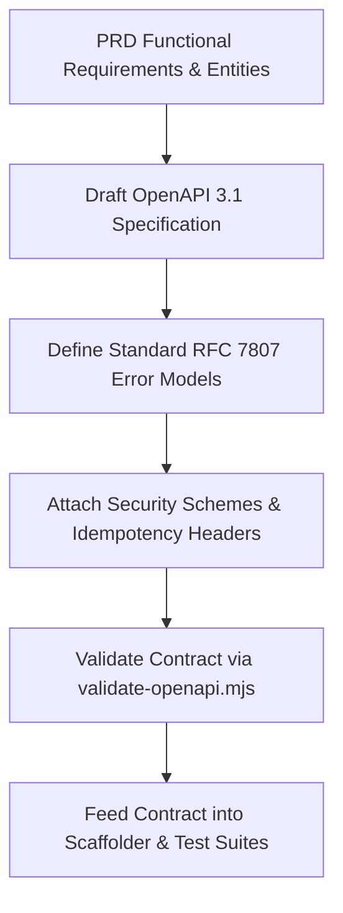

# API Contract Designer (Phase 2/3: Contract-First Design)

This skill guides coding agents to establish unambiguous, machine-readable API contracts before implementing endpoints. It ensures that backend services, frontend consumers, and automated integration tests share a single source of truth.

---

## Contract-First Workflow



---

## Step-by-Step Procedure

### Step 1: Extract Endpoints from PRD
1. Review the `PRD.md` data flows and functional requirements (`FR-XXX`).
2. Identify resources and operations following RESTful principles:
   - `GET /api/v1/resources` — List with pagination and filtering
   - `POST /api/v1/resources` — Create resource (idempotent when appropriate)
   - `GET /api/v1/resources/{id}` — Retrieve by ID
   - `PUT / PATCH /api/v1/resources/{id}` — Update or partial mutate
   - `DELETE /api/v1/resources/{id}` — Remove or archive

### Step 2: Implement the OpenAPI 3.1 Contract
Using the [OpenAPI Template](./templates/openapi-template.yaml):
- Define complete `schemas` with strict types, constraints (`minLength`, `maxLength`, `minimum`), and `required` fields.
- Avoid loose `type: object` without defined properties.
- Use **RFC 7807 Problem Details** for all error responses (400, 401, 404, 409, 500).

### Step 3: Security & Header Specification
- Declare security schemes under `components.securitySchemes` (e.g., Bearer JWT, API Key).
- Include standard operational headers:
  - `X-Request-Id` (UUID for distributed tracing)
  - `Idempotency-Key` (for write operations subject to network retries)

### Step 4: Validate Contract
Run the OpenAPI contract validation script:
```bash
node .agents/skills/api-contract-designer/scripts/validate-openapi.mjs <path-to-openapi.yaml-or-json>
```

---

## Supporting Resources
- [OpenAPI 3.1 Template](./templates/openapi-template.yaml)
- [RESTful API Guidelines](./references/api-guidelines.md)
