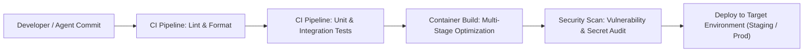

# CI/CD & Container Automator (Phase 6: Deployment)

This skill guides coding agents to produce production-grade containerization assets and continuous integration/delivery workflows. It enforces security hardening (non-root users, minimal attack surface) and automated quality verification on every commit.

---

## Deployment & Pipeline Architecture



---

## Step-by-Step Procedure

### Step 1: Scaffold Multi-Stage Dockerfile
Use [templates/Dockerfile.template](./templates/Dockerfile.template):
1. **Base Stage:** Use a minimal, locked Alpine or Slim image.
2. **Build Stage:** Install dev dependencies, compile TypeScript or assets, prune dev dependencies.
3. **Runner Stage:**
   - Copy only compiled artifacts and production dependencies.
   - Run as an **unprivileged user** (never `root`).
   - Define a healthcheck endpoint (`HEALTHCHECK CMD curl -f http://localhost:PORT/health || exit 1`).

### Step 2: Configure `.dockerignore`
Ensure secrets, local build artifacts, and test caches are excluded:
- `.git`, `.env*`, `node_modules`, `coverage`, `tests`

### Step 3: Scaffold CI/CD Pipeline
Use [templates/ci-workflow-template.yml](./templates/ci-workflow-template.yml):
- Trigger on `pull_request` and `push` to `main`.
- Enforce the pipeline gate sequence:
  1. **Lint & Static Check:** Fails fast if formatting or types are broken.
  2. **Automated Testing:** Runs unit test suites.
  3. **Container Build & Verification:** Builds image without publishing to verify compilation.

### Step 4: Validate CI/CD & Container Configs
Run the verification script:
```bash
node .agents/skills/cicd-container-automator/scripts/validate-ci-container.mjs <repo-or-config-dir>
```

---

## Supporting Resources
- [Multi-Stage Dockerfile Template](./templates/Dockerfile.template)
- [GitHub Actions CI Workflow Template](./templates/ci-workflow-template.yml)
