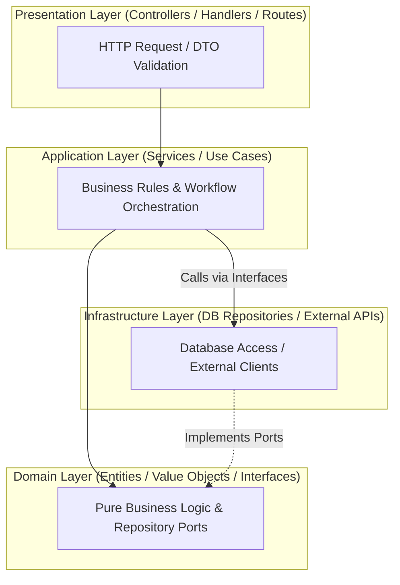

# Feature Scaffolder (Phase 4: Implementation / Coding)

This skill directs coding agents to translate functional specifications into clean, layered, and maintainable software architectures. It enforces domain boundary separation, dependency inversion, and strict typing.

---

## Architecture Blueprint (Layered / Clean Architecture)



---

## Step-by-Step Scaffolding Procedure

### Step 1: Read and Bind to the PRD
1. Read the target PRD (produced by `prd-generator-validator`).
2. Identify all `FR-XXX` requirements and Data Models.
3. Establish the module/domain name (e.g., `billing`, `auth`, `order-fulfillment`).

### Step 2: Scaffold Domain Entities & Interfaces (Pure Logic)
- Create domain entities with complete type safety.
- **Rule:** Domain entities must NOT import database drivers, web frameworks, or ORM annotations.
- Define abstract repository or service ports (interfaces):
  ```typescript
  // Example: domain/ports/order-repository.port.ts
  export interface IOrderRepository {
    findById(id: string): Promise<Order | null>;
    save(order: Order): Promise<void>;
  }
  ```

### Step 3: Implement Application Services (Use Cases)
- Build service classes that orchestrate business logic.
- Inject dependencies via constructors using interfaces (Dependency Inversion Principle).
- Handle domain-specific business errors explicitly using typed error classes or Result wrappers (never generic `throw new Error()`).

### Step 4: Implement Infrastructure Adapters
- Implement repository interfaces using the project's chosen persistence layer (e.g., Prisma, Drizzle, TypeORM, Raw SQL, or In-Memory mocks).
- Ensure queries and DB transactions are strictly isolated to this layer.

### Step 5: Implement Presentation Handlers & DTOs
- Create controller/handler routes.
- Validate request inputs against strict DTO schemas (e.g., Zod, Joi, class-validator) *before* reaching services.
- Map domain error types to standardized HTTP status codes:
  - `EntityNotFoundError` $\rightarrow$ `404 Not Found`
  - `DuplicateEntityError` $\rightarrow$ `409 Conflict`
  - `ValidationError` $\rightarrow$ `400 Bad Request`
  - `UnauthorizedError` $\rightarrow$ `401 Unauthorized`

### Step 6: Verify Structure
Run the scaffold verification helper:
```bash
node .agents/skills/feature-scaffolder/scripts/verify-scaffold.mjs <feature-directory>
```
Once verified, proceed to **Phase 5: `unit-test-synthesizer`**.

---

## Supporting Resources
- [Architecture Patterns Reference](./references/architecture-patterns.md)
- [Domain Model & Service Template](./templates/domain-model-template.md)
