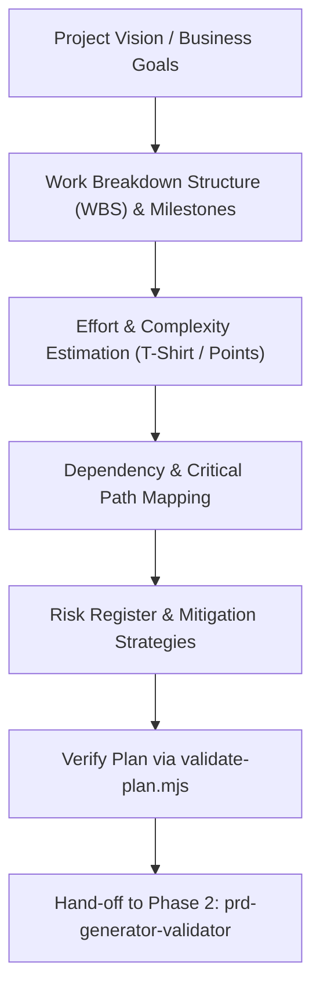

# Project Planner & Estimator (Phase 1: Planning)

This skill guides coding agents and project teams to plan execution sprints, estimate technical complexity, identify critical path dependencies, and maintain a proactive risk management register.

---

## Planning Workflow



---

## Step-by-Step Procedure

### Step 1: Define Milestones & WBS
1. Identify major release milestones (e.g., M1: Core Domain Engine, M2: API & Persistence, M3: Release & Security).
2. Decompose each milestone into prioritized tasks using the [Project Plan Template](./templates/project-plan-template.md).

### Step 2: Technical Effort Estimation
- Estimate complexity using standard T-shirt sizing (S, M, L, XL) or Fibonacci story points.
- Identify "Technical Spikes" (investigative research tasks) for unknown third-party APIs or unverified performance bottlenecks.

### Step 3: Risk Assessment & Mitigation
Document potential risks in the Risk Register:
- **Technical Risks:** (e.g., rate limits on external services, database scaling).
- **Dependency Risks:** (e.g., unreleased libraries, third-party auth outages).
- Define concrete **Mitigation Plans** for every risk rated Medium or High.

### Step 4: Plan Validation
Run the plan validation script:
```bash
node .agents/skills/project-planner-estimator/scripts/validate-plan.mjs <path-to-project-plan.md>
```

---

## Supporting Resources
- [Project Plan Template](./templates/project-plan-template.md)
