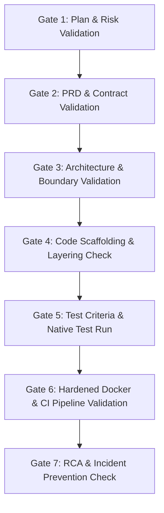

# Quality Gate Orchestrator (Cross-Cutting SDLC Verification)

This skill serves as the central verification hub of SkillForgeAI. It runs automated quality gates across all phases, guaranteeing that neither coding agents nor human engineers transition across SDLC boundaries with invalid, incomplete, or broken assets.

---

## SDLC Phase Gate Matrix



---

## Unified Quality Gate CLI

Run the master orchestrator script to check a specific gate or the entire project:

```bash
# Run all quality gates on the repository
node .agents/skills/quality-gate-orchestrator/scripts/run-all-gates.mjs

# Or invoke a specific phase gate:
node .agents/skills/quality-gate-orchestrator/scripts/run-all-gates.mjs --phase 2
node .agents/skills/quality-gate-orchestrator/scripts/run-all-gates.mjs --phase 4
node .agents/skills/quality-gate-orchestrator/scripts/run-all-gates.mjs --phase 5
```

---

## Phase Gate Standards

| Phase | Gate Name | Tool / Script | Exit Criteria |
| :--- | :--- | :--- | :--- |
| **Phase 1** | Plan & Feasibility Gate | `validate-plan.mjs` | WBS defined, milestones scheduled, risks mitigated. |
| **Phase 2** | Requirements Gate | `validate-prd.mjs` & `validate-openapi.mjs` | Numbered FRs, Given-When-Then criteria, zero ambiguity. |
| **Phase 3** | Architecture Gate | `validate-architecture.mjs` | C4 context & container diagrams, ADR trade-offs recorded. |
| **Phase 4** | Scaffolding Gate | `verify-scaffold.mjs` | Zero infrastructure leaks into domain layer, typed errors. |
| **Phase 5** | Test & Quality Gate | `verify-coverage-criteria.mjs` & test runner | 100% test pass rate, AAA structure, FRs explicitly cited. |
| **Phase 6** | Deployment Gate | `validate-ci-container.mjs` | Multi-stage build, non-root user, automated CI checks. |
| **Phase 7** | Maintenance Gate | `validate-rca.mjs` | 5-Whys root cause documented, regression test added. |
