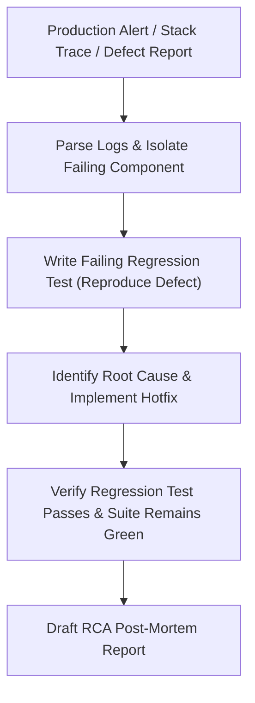

# Incident & Root Cause Analyzer (Phase 7: Maintenance & Operations)

This skill equips coding agents to triage production incidents, reconstruct defect reproduction harnesses, pinpoint root causes in the codebase, and verify that hotfix patches resolve the defect without breaking existing features.

---

## Incident Remediation Workflow



---

## Step-by-Step Procedure

### Step 1: Ingest Error Telemetry
1. Read the incident report, error stack trace, or customer bug ticket.
2. Identify the failing module, specific line numbers, and input parameters that triggered the fault.

### Step 2: Reproduce the Defect via Test Case (Crucial Step)
- **Rule:** Never attempt to fix a defect without first creating a test that reliably reproduces the failure.
- Add a new test case in the appropriate test suite:
  ```typescript
  it('should not crash when input payload contains duplicate null elements (BUG-1042)', async () => {
    // Arrange: failing inputs from production trace
    // Act & Assert: reproduction of expected correct behavior
  });
  ```
- Run the test runner to confirm that the test **FAILS** for the exact reported reason.

### Step 3: Implement the Minimal Hotfix
- Apply the targeted fix in the domain or service layer.
- Run the test suite: the new regression test must now **PASS**, and all prior unit tests must remain green.

### Step 4: Author Root Cause Analysis (RCA) Report
Populate the [RCA Report Template](./templates/rca-report-template.md) in `docs/incidents/RCA-YYYY-MM-DD-[title].md`:
- Incident summary & severity
- Timeline of events
- 5-Whys root cause determination
- Corrective actions & preventive measures

### Step 5: Validate RCA Document
```bash
node .agents/skills/sfa-incident-root-cause-analyzer/scripts/validate-rca.mjs <path-to-rca-report.md>
```

---

## Supporting Resources
- [RCA Report Template](./templates/rca-report-template.md)
