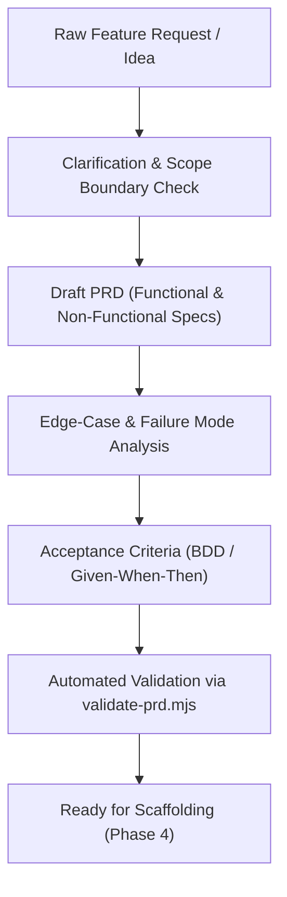

# PRD Generator & Validator

This skill equips coding agents to turn abstract requirements into actionable, ambiguity-free Product Requirement Documents (PRDs). It guarantees that scope boundaries, functional contracts, edge cases, and acceptance criteria are codified before any code is generated.

---

## Workflow Steps



### Step 1: Input Analysis & Scope Boundary Check
1. Read the user's initial prompt or ticket.
2. Determine explicit **In-Scope** vs. **Out-of-Scope** boundaries to prevent feature creep.
3. If critical decisions are ambiguous (e.g., auth mechanism, database type, scale expectations), ask targeted clarification questions before drafting assumptions.

### Step 2: Draft the Specification
Populate the [PRD Template](./templates/prd-template.md) with:
- **Problem Statement & Target Persona**: Who is this for and why?
- **Functional Requirements (`FR-XXX`)**: Explicit, numbered functional requirements. Avoid vague statements like "should be fast" or "handle errors nicely".
- **Non-Functional Requirements (`NFR-XXX`)**: Latency, concurrency, availability, and security baselines.
- **Data & Contract Preview**: Payload samples, schema previews, or state transitions.

### Step 3: Edge-Case & Failure Mode Enumeration
Consult the [Edge-Case Checklist](./references/edge-case-checklist.md).
Explicitly specify system behavior for:
- Invalid, malicious, or malformed inputs.
- Empty states and boundary values (e.g., zero items, max pagination, payload > limit).
- Network delays, external dependency outages, or concurrency race conditions.
- Idempotency and duplicate request handling.

### Step 4: Define Verifiable Acceptance Criteria
Write Acceptance Criteria using the **Given-When-Then** (BDD) structure for each functional requirement:
- `Given` initial system state and preconditions.
- `When` specific user action or API trigger occurs.
- `Then` observable outcome and state changes.

### Step 5: Automated Validation
Run the built-in validation script against the drafted PRD markdown:
```bash
node .agents/skills/sfa-prd-generator-validator/scripts/validate-prd.mjs <path-to-prd.md>
```
Ensure all required sections pass validation with 0 errors before handing off to the **`sfa-feature-scaffolder`** skill.

---

## Output Standard
Every completed PRD must follow the schema defined in [templates/prd-template.md](./templates/prd-template.md).
