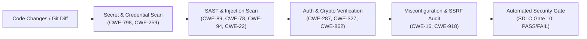

# Security Vulnerability & Weakness Auditor (Phase 6: Security & Deployment)

This skill guides AI coding assistants to audit source code changes, applications, and configurations for security vulnerabilities, exposed credentials, and software weaknesses commonly targeted by malicious actors. It enforces **Shift-Left DevSecOps** principles, ensuring that vulnerabilities are identified and remediated before code merges to main or deploys to production.

---

## Security Audit & Vulnerability Lifecycle



---

## Top Hacker Attack Vectors & CWE Mapping

| Hacker Attack Vector | Primary CWEs | Exploit Mechanism | Defense Pattern |
| :--- | :--- | :--- | :--- |
| **SQL Injection (SQLi)** | `CWE-89` | Malicious input breaks out of SQL query literals | Parameterized queries, ORM/query builders, type-safe inputs |
| **OS Command Injection** | `CWE-78` | Shell metacharacters (`&&`, `\|`, `;`, `$()`) execute arbitrary commands | Avoid shell execution; pass argument arrays; strict input validation |
| **Path Traversal / LFI** | `CWE-22` | Directory navigation (`../`, `..\`) accesses arbitrary files | Whitelist paths, resolve absolute path & assert boundary prefix |
| **Code Injection / Unsafe Deserialization** | `CWE-94`, `CWE-502` | Unsafe evaluation of dynamic payloads (`eval`, `new Function`, pickle) | Avoid runtime evaluation; use safe JSON serialization |
| **Hardcoded Secrets & Keys** | `CWE-798`, `CWE-259` | Attackers extract API keys, tokens, or private keys from repos | Environment variables, cloud secret managers, vault integration |
| **Broken Cryptography** | `CWE-327`, `CWE-328` | Collision attacks on MD5/SHA1, weak RNG for auth tokens | SHA-256/SHA-512, Argon2/bcrypt for passwords, CSPRNG (`crypto.randomBytes`) |
| **Missing Auth / IDOR** | `CWE-287`, `CWE-862` | Unauthenticated access or unauthorized object ID manipulation | Authentication middleware on all private routes, tenant/owner ID checks |
| **Server-Side Request Forgery (SSRF)** | `CWE-918` | Server coerced into requesting internal services / cloud metadata | Strict URL allowlisting, block internal CIDR blocks (127.0.0.1, 169.254.169.254) |
| **Security Misconfiguration** | `CWE-16`, `CWE-942` | Permissive CORS with credentials, debug pages enabled in production | Explicit CORS origins, disable verbose stack traces in production |

---

## Step-by-Step Procedure

### Step 1: Threat Surface & Entry Point Analysis
Before committing or approving changes, identify all external entry points:
1. **Public Endpoints & Parameters:** HTTP routes, query strings, headers, request bodies.
2. **Third-Party Integrations:** Webhooks, message queue consumers, external API responses.
3. **Data Boundaries:** File uploads, database persistence, inter-service gRPC/RPC calls.
4. Complete the [Threat Matrix Template](./templates/threat-matrix-template.md) for significant feature additions.

### Step 2: Incremental Change & Secret Leak Audit
Inspect the staged Git diff or active changes for sensitive information:
- High-entropy tokens, private keys, database connection strings, JWT signing keys.
- Command:
  ```bash
  node bin/skillforge.mjs security --diff
  ```

### Step 3: Static Application Security Testing (SAST)
Audit source files across the project for dangerous functions and vulnerable code patterns:
- Insecure sinks: `eval()`, `exec()`, `execSync()`, `Process.Start`, `innerHTML`.
- Cryptographic weaknesses: `md5`, `sha1` used for passwords; `Math.random()` used for tokens.
- Command:
  ```bash
  node bin/skillforge.mjs security --path <target-directory>
  ```

### Step 4: Supply Chain & Dependency Review
Check manifest files (`package.json`, `.csproj`, `requirements.txt`) for:
- Known vulnerable packages or unpinned floating dependency versions.
- Development dependencies bundled into production containers.

### Step 5: Enforce Quality Gate & Synthesize Remediation
Run the automated security gate to verify compliance:
```bash
node bin/skillforge.mjs gate --phase 6
```
If vulnerabilities are found:
1. Provide actionable diffs replacing vulnerable patterns with secure implementations.
2. Document findings in a [Security Audit Report](./templates/security-audit-report-template.md).
3. Re-run verification until all critical and high severity issues are eliminated.

---

## Supporting Resources & Templates
- [Security Audit Report Template](./templates/security-audit-report-template.md)
- [Threat Matrix Template](./templates/threat-matrix-template.md)
- [OWASP Top 10 & CWE Cheatsheet](./references/owasp-top-10-cwe-cheatsheet.md)
