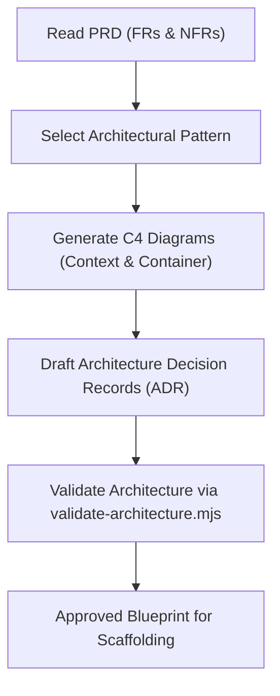

# System Architecture & ADR Designer (Phase 3: Design)

This skill directs coding agents to translate business requirements (`PRD.md`) into high-level and low-level architectural blueprints. It produces C4 diagrams, defines service boundaries, and maintains an immutable log of Architecture Decision Records (ADRs).

---

## Workflow Steps



### Step 1: Input Analysis
1. Read the approved `PRD.md` from Phase 2.
2. Note all Non-Functional Requirements (NFRs), particularly:
   - Expected concurrency and throughput
   - Latency thresholds
   - Security and compliance boundaries
   - Data consistency requirements (ACID vs. Eventual Consistency)

### Step 2: Architecture Decision Record (ADR) Creation
For every non-trivial technical choice (database engine, state management, auth mechanism, caching strategy), generate an ADR in `docs/adr/ADR-XXXX-[title].md` using the [ADR Template](./templates/adr-template.md).
- Status must be `Proposed` or `Accepted`.
- Explicitly state **Context**, **Decision**, and **Consequences** (both positive and negative trade-offs).

### Step 3: Draft Architecture Specification (`ARCHITECTURE.md`)
Populate the [Architecture Specification Template](./templates/architecture-spec-template.md):
- **C4 Context Diagram:** Visualizes system actors and external integrations.
- **C4 Container Diagram:** Visualizes web apps, APIs, databases, caches, and queues.
- **Boundary Rules:** Explicit rules preventing cross-domain coupling (e.g., Domain must not import Infrastructure).

### Step 4: Automated Verification
Run the architecture verification script:
```bash
node .agents/skills/sfa-system-architecture-adr/scripts/validate-architecture.mjs <path-to-architecture.md>
```

---

## Supporting Resources
- [ADR Template](./templates/adr-template.md)
- [Architecture Spec Template](./templates/architecture-spec-template.md)
- [C4 Model Guide](./references/c4-model-guide.md)
