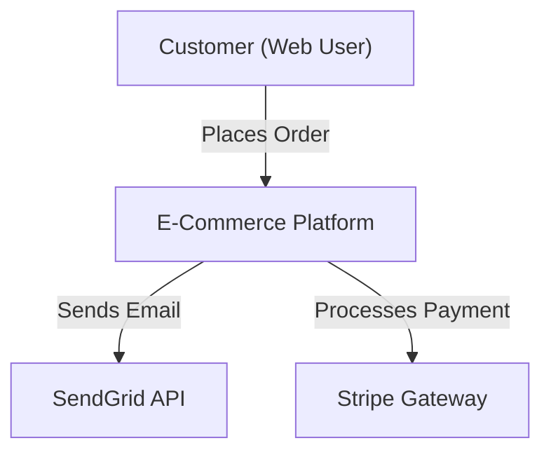
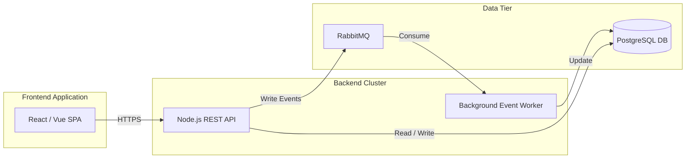

# C4 Architecture Modeling Guide for Coding Agents

The C4 model (Context, Containers, Components, and Code) is the industry-standard way to visually communicate software architecture through code and markdown diagrams.

---

## 1. Level 1: System Context Diagram
- **Purpose:** Answers "Who is using this system and what external systems does it interact with?"
- **Zoom Level:** Highest view. Shows your system as a black box surrounded by users and external dependencies.
- **Recommended Mermaid Diagram:** `graph TD` or `flowchart TD`

---

## 2. Level 2: Container Diagram
- **Purpose:** Answers "What are the high-level deployable units (containers) of the system?"
- **Zoom Level:** Zooms into your system. Shows web browsers, mobile apps, backend services, databases, queues, and file stores.
- **Recommended Mermaid Diagram:** `graph LR` with subgraphs.

---

## 3. Level 3: Component Diagram
- **Purpose:** Answers "What are the major structural building blocks within a specific service/container?"
- **Zoom Level:** Inside a single application container, showing Controllers, Services, Repositories, and Adapters.

---

## 4. Key Rules for Agents Writing Diagrams
1. **Always Label Arrows:** An arrow with no label is ambiguous. State the protocol or action (e.g., `-->|HTTPS / JSON|` or `-->|SQL Query|`).
2. **Use Clear Node Types:** Distinguish databases `DB[("PostgreSQL")]` from services `API["Service"]`.
3. **Keep Mermaid Syntax Valid:** Quote node labels containing spaces or special characters.
