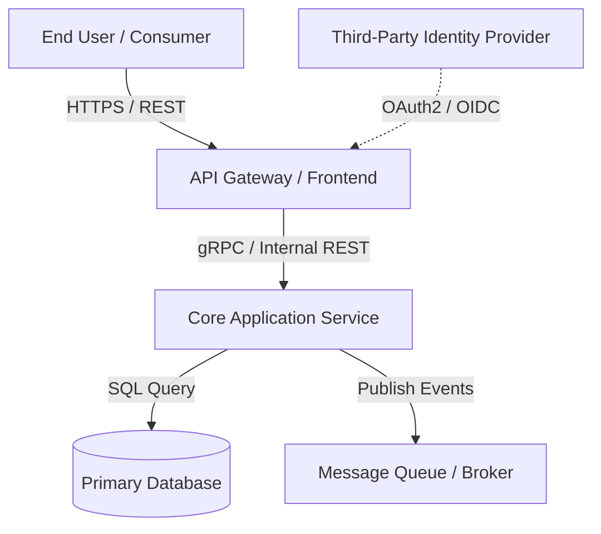
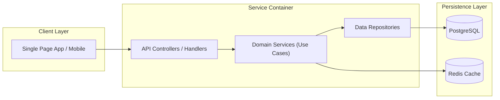

# System Architecture Document: [System Name]

- **Status:** Draft | In Review | Approved
- **Author:** [Solution Architect / Agent]
- **Date:** YYYY-MM-DD
- **Target SDLC Phase:** Phase 3 (Architecture & Technical Design)

---

## 1. Architectural Drivers & Goals
- **Primary Business Goal:** [e.g., Enable scalable, real-time inventory management]
- **Key Quality Attributes:** [e.g., High availability, sub-100ms response time, modular deployability]

---

## 2. System Context (C4 Level 1)

---

## 3. Container & Component Architecture (C4 Level 2)

---

## 4. Architectural Boundaries & Data Flow
- **Boundary Rule 1:** The Domain Layer contains zero external infrastructure imports.
- **Boundary Rule 2:** All asynchronous commands pass through the durable event broker.
- **Boundary Rule 3:** Sensitive data (passwords, tokens, PII) must be encrypted at rest and in transit.

---

## 5. Security & Network Architecture
- **Authentication:** [JWT Bearer / Session Cookies]
- **Authorization:** Role-Based Access Control (RBAC) enforced at the API route layer.
- **Data Protection:** TLS 1.3 in transit; AES-256 at rest.

---

## 6. Index of Architecture Decision Records (ADRs)

| ADR ID | Decision Title | Status | Date |
| :--- | :--- | :--- | :--- |
| **ADR-0001** | Selection of PostgreSQL for Relational Data | Accepted | YYYY-MM-DD |
| **ADR-0002** | Adoption of Clean Architecture Layering | Accepted | YYYY-MM-DD |
