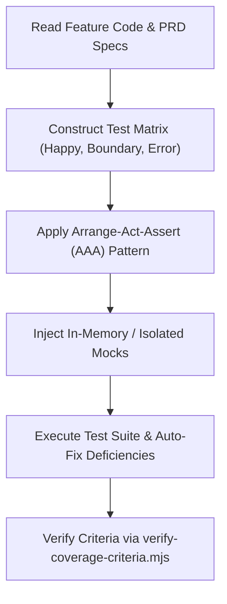

# Unit Test Synthesizer (Phase 5: Testing & QA)

This skill guides coding agents to produce rigorous, maintainable, and isolated unit tests. It ensures test suites directly trace back to the requirements (`FR-XXX`), acceptance criteria, and edge cases (`EC-XXX`) established in the PRD.

---

## Test Synthesis Workflow



---

## Step-by-Step Test Generation Procedure

### Step 1: Trace Requirements
1. Review the corresponding `PRD.md` requirements (`FR-001`, `FR-002`, etc.) and edge cases (`EC-001`, etc.).
2. Cross-reference the source files scaffolded in Phase 4.
3. Every test block must include a reference tag in its description:
   ```typescript
   it('should create feature successfully when valid (FR-001)', async () => { ... });
   it('should reject duplicate feature name with 409 Conflict (EC-001)', async () => { ... });
   ```

### Step 2: Build the Test Matrix
Follow the [Test Matrix Template](./templates/test-matrix-template.md):
- **Happy Path:** Expected valid input producing desired output state.
- **Boundary Conditions:** Empty strings, minimum/maximum integers, zero values, max pagination limits.
- **Negative / Error Cases:** Invalid types, missing required attributes, domain rule violations (must assert specific custom error types).
- **Idempotency & Race Protection:** Calling identical operations twice to verify state integrity.

### Step 3: Implement Arrange-Act-Assert (AAA)
Ensure strict visual separation between setup, execution, and verification:
```typescript
it('should transition status from PENDING to ACTIVE (FR-002)', () => {
  // Arrange
  const entity = FeatureEntity.create('Analytics Module');

  // Act
  entity.activate();

  // Assert
  expect(entity.toJSON().status).toBe('ACTIVE');
  expect(entity.toJSON().updatedAt).toBeInstanceOf(Date);
});
```

### Step 4: Follow Mocking Rules
Read the [Mocking Guidelines](./references/mocking-guidelines.md):
- Prefer **in-memory fakes/adapters** (e.g., `InMemoryFeatureRepository`) over complex mock frameworks.
- Only mock external boundaries (DB, network, message queues, time). **Never mock the unit under test or pure domain entities.**

### Step 5: Execute and Self-Correct
1. Run the project's test runner (e.g., `npm test`, `npx vitest run`, `node --test`).
2. If any test fails, determine whether the defect is in the implementation code or the test assertion.
3. Fix the implementation or assertion autonomously before completing the turn.

### Step 6: Verify Test Suite Standards
Run the test criteria verification script:
```bash
node .agents/skills/unit-test-synthesizer/scripts/verify-coverage-criteria.mjs <path-to-test-dir-or-file>
```

---

## Supporting Resources
- [Test Matrix Template](./templates/test-matrix-template.md)
- [Mocking Guidelines](./references/mocking-guidelines.md)
