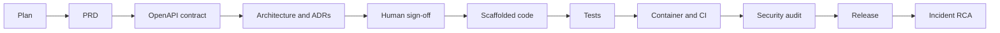

# SkillForgeAI Getting Started

SkillForgeAI is a framework for AI-assisted software delivery. It provides a set of
agent skills, validation scripts, and quality gates that guide an AI coding agent
through planning, requirements, architecture, implementation, testing, security, and
maintenance. The same artifacts are checked locally and in CI, so the process is
consistent whether you work in an editor or open a pull request.

The framework is language- and editor-agnostic. This guide covers installation,
configuration, the phase workflow, the command line interface, and operational
details for teams adopting it in a new or existing repository.

## Table of Contents

1. [Overview](#1-overview)
2. [Requirements](#2-requirements)
3. [How It Works](#3-how-it-works)
4. [Quick Start](#4-quick-start)
5. [Working Through the Phases](#5-working-through-the-phases)
6. [Command Reference](#6-command-reference)
7. [Configuration](#7-configuration)
8. [CI and Automation](#8-ci-and-automation)
9. [Agent Context and Editor Sync](#9-agent-context-and-editor-sync)
10. [Daily Workflow and Maintenance](#10-daily-workflow-and-maintenance)
11. [Principles and Governance](#11-principles-and-governance)
12. [Troubleshooting](#12-troubleshooting)
13. [Reference](#13-reference)

## 1. Overview

SkillForgeAI has three building blocks:

- **Skills** are instruction files in `.agents/skills/<skill-name>/SKILL.md`. They tell
  an AI coding agent what to produce in a given phase and which constraints to respect.
- **Validators** are Node.js scripts that inspect the resulting artifact. They parse
  OpenAPI documents, Markdown sections, Dockerfiles, test files, and source trees rather
  than checking for a few header strings.
- **Quality gates** map validators to project artifacts. A gate passes only when its
  artifact satisfies the rules for that phase.

A typical feature moves through the following artifacts:



Each transition is guarded by a gate. Gates are fail-closed: when a required artifact is
missing or cannot be validated, the gate fails instead of assuming success.

The `scaffold` command generates TypeScript and .NET templates today. The skills and
validators are not limited to those stacks.

## 2. Requirements

| Requirement | Version | Notes |
|:---|:---|:---|
| Node.js | 22.6 or newer | Node 24 is recommended and used by CI |
| Git | Any recent version | Required for change analysis and sign-off verification |
| .NET SDK | 10 (optional) | Only needed for the C# example and its tests |
| AI coding agent | Any supported editor | Antigravity, Cursor, Claude Code, Windsurf, OpenCode, or VSCode Copilot |

Install the runtime dependencies from the repository root:

```bash
npm ci
```

> [!NOTE]
> Run `npm ci` before using the CLI from a source checkout. The parser and validator
> modules depend on runtime packages such as `yaml` and `tree-sitter`. The published
> package installs these dependencies automatically.

Verify the toolchain:

```bash
node --version    # 22.6 or newer
git --version
dotnet --version  # Optional
```

## 3. How It Works

The framework organizes delivery into seven phases. Ten quality gates cover the
transition points; some phases have more than one gate, and human sign-off sits between
Phases 3 and 4.

| Phase | Gate ID | Artifact key | Validator |
|:---|:---|:---|:---|
| 1. Planning | `plan` | `plan` | `validate-plan.mjs` |
| 2. Requirements | `prd` | `prd` | `validate-prd.mjs` |
| 2/3. API contract | `openapi` | `openapi` | `validate-openapi.mjs` |
| 3. Architecture | `architecture` | `architecture` | `validate-architecture.mjs` |
| 3 to 4. Human sign-off | `signoff` | `signoff` | `verify-human-signoff.mjs` |
| 4. Scaffolding | `scaffold` | `src` | `verify-scaffold.mjs` |
| 5. Tests | `tests` | `tests` | `verify-coverage-criteria.mjs` |
| 6. Container and CI | `container` | `dockerfile` | `validate-ci-container.mjs` |
| 6. Security | `security` | `src` | `audit-security.mjs` |
| 7. Maintenance | `rca` | `rca` | `validate-rca.mjs` |

The `src` artifact key is shared by the scaffolding and security gates, so both checks
run against the same source tree.

### Modes

| Mode | When it is used | What it checks |
|:---|:---|:---|
| `project` | `skillforge.config.json` exists and sets `"mode": "project"` | Your artifacts, resolved from the configured paths and globs |
| `self-test` | The config sets `"mode": "self-test"`, or `--self-test` is passed | The framework's own templates and example artifacts |
| none | No config and no `--self-test` | `FAILED` (fail closed) |

A missing `skillforge.config.json` does **not** silently downgrade to self-test:
`skillforge gate` fails unless `--self-test` is passed explicitly. This keeps an
agent from deleting the config to obtain a green run.

In project mode, a missing required artifact fails the gate. `--allow-missing`
reports unconfigured artifacts as skipped, but the run still exits non-zero while
any required gate is skipped.

### Key terms

| Term | Meaning |
|:---|:---|
| PRD | Product Requirements Document; the source of functional requirements and edge cases |
| FR / EC / NFR | Functional requirement, edge case, and non-functional requirement identifiers |
| ADR | Architecture Decision Record; a short document recording a design decision |
| HITL | Human-in-the-loop; a human approval that an AI agent cannot grant on its own |
| WBS | Work Breakdown Structure; the task and milestone breakdown in the project plan |
| Gate | An automated check that must pass before work proceeds to the next phase |

## 4. Quick Start

### Path A: Start from the framework repository

Use this path when you want the complete framework, examples, and reference artifacts in
one repository. If you only need the framework in an existing application, use Path B.

```bash
git clone https://github.com/rishikesh-net/SkillForgeAI.git my-project
cd my-project
npm ci
node bin/skillforge.mjs init
```

Update the `name` and `description` fields in `package.json` for your project. `init`
installs the Git hooks, synchronizes editor instructions, generates the code graph, and
creates the domain slice maps. `sync` can be run again at any time to regenerate editor
configuration files after skills change. The generated files are listed under
[Editors](#editors).

Run the gates once to confirm the installation:

```bash
node bin/skillforge.mjs gate
```

The repository ships with a self-test configuration. When you start validating your own
artifacts, create a project configuration as described in [Configuration](#7-configuration).

### Path B: Adopt the framework in an existing repository

Run the following steps from your project root.

1. Copy the runtime directories and configuration files from the framework repository:

   ```bash
   # macOS / Linux
   cp -r <path-to-SkillForgeAI>/.agents .
   cp -r <path-to-SkillForgeAI>/bin .
   cp -r <path-to-SkillForgeAI>/src .
   cp -r <path-to-SkillForgeAI>/scripts .
   cp -r <path-to-SkillForgeAI>/templates .
   cp <path-to-SkillForgeAI>/skillforge.config.example.json .
   cp <path-to-SkillForgeAI>/skillforge.config.schema.json .
   cp <path-to-SkillForgeAI>/gate-policy.json .
   ```

   ```powershell
   # Windows PowerShell
   Copy-Item -Recurse <path-to-SkillForgeAI>\.agents   .
   Copy-Item -Recurse <path-to-SkillForgeAI>\bin       .
   Copy-Item -Recurse <path-to-SkillForgeAI>\src       .
   Copy-Item -Recurse <path-to-SkillForgeAI>\scripts   .
   Copy-Item -Recurse <path-to-SkillForgeAI>\templates .
   Copy-Item <path-to-SkillForgeAI>\skillforge.config.example.json .
   Copy-Item <path-to-SkillForgeAI>\skillforge.config.schema.json .
   Copy-Item <path-to-SkillForgeAI>\gate-policy.json .
   ```

   > [!IMPORTANT]
   > Copy `src` as well as `bin`. The CLI entrypoint imports the shared engines and
   > validators from `src/core`; copying only `bin`, `scripts`, and `.agents` leaves the
   > installation incomplete.

2. Add the npm scripts for convenience:

   ```json
   {
     "scripts": {
       "skillforge": "node bin/skillforge.mjs",
       "gate": "node bin/skillforge.mjs gate",
       "security": "node bin/skillforge.mjs security",
       "diff": "node bin/skillforge.mjs diff",
       "graph": "node bin/skillforge.mjs graph",
       "slice": "node bin/skillforge.mjs slice",
       "scaffold": "node bin/skillforge.mjs scaffold",
       "signoff": "node bin/skillforge.mjs signoff",
       "heal": "node bin/skillforge.mjs heal",
       "sync": "node bin/skillforge.mjs sync"
     }
   }
   ```

3. Install the runtime dependencies:

   ```bash
   npm install yaml tree-sitter tree-sitter-typescript tree-sitter-javascript tree-sitter-c-sharp tree-sitter-python tree-sitter-go
   ```

   Full OpenAPI schema validation additionally uses an optional package:

   ```bash
   npm install --save-dev @apidevtools/swagger-parser
   ```

   Without it, the OpenAPI validator still performs structural checks and emits a
   warning.

4. Initialize the environment:

   ```bash
   node bin/skillforge.mjs init
   ```

5. Create your project configuration:

   ```bash
   cp skillforge.config.example.json skillforge.config.json
   ```

   Set `"mode": "project"` and point each artifact key at your files. See
   [Configuration](#7-configuration) for the full shape.

6. Record a baseline:

   ```bash
   node bin/skillforge.mjs gate --json > baseline-audit.json
   ```

   The report lists which phases pass and which artifacts still need work. The command
   exits non-zero while required artifacts are missing, but the JSON report is still
   written.

7. Copy the gate workflow from `.github/workflows/skillforge-gate.yml` if you want the
   pull request scorecard. The workflow runs `npm ci`, so your repository needs a
   lockfile or an equivalent install step.

## 5. Working Through the Phases

Invoke a skill by name in your AI agent, for example: “Use the
`sfa-prd-generator-validator` skill to write a PRD for the billing feature.” The agent
reads the skill instructions and produces the artifact. Run `skillforge gate` after each
phase to verify the result.

### 5.1 Phase 1: Planning

- **Skill:** `sfa-project-planner-estimator`
- **Produces:** a project plan with milestones, a work breakdown structure, estimates,
  and a risk register.
- **Location:** `docs/plan.md`
- **Gate:** `plan` (`validate-plan.mjs`)

### 5.2 Phase 2: Requirements

- **Skill:** `sfa-prd-generator-validator`
- **Produces:** a PRD with numbered functional requirements (`FR-001`), non-functional
  requirements, edge cases (`EC-001`), explicit scope boundaries, and Given-When-Then
  acceptance criteria.
- **Location:** `docs/<feature>.prd.md`
- **Gate:** `prd` (`validate-prd.mjs`)
- **Example:** `examples/order-service/order-service.prd.md`

The PRD is the reference for tests and traceability. Avoid starting implementation until
it has been reviewed and the requirements are unambiguous.

### 5.3 Phase 2/3: API contract

- **Skill:** `sfa-api-contract-designer`
- **Produces:** an OpenAPI 3.0 or 3.1 document with request and response schemas,
  RFC 7807 problem details, and security schemes.
- **Location:** `openapi.yaml` (or `.json`)
- **Gate:** `openapi` (`validate-openapi.mjs`)

The validator parses the document, checks versions, paths, operations, responses,
component schemas, and security schemes, and can run full schema validation when the
optional `swagger-parser` dependency is installed.

### 5.4 Phase 3: Architecture

- **Skill:** `sfa-system-architecture-adr`
- **Produces:** C4 context and container diagrams and Architecture Decision Records.
- **Location:** `ARCHITECTURE.md` and `docs/adr/ADR-0001-<title>.md`
- **Gate:** `architecture` (`validate-architecture.mjs`)

### 5.5 Phase 3 to 4: Human sign-off

Human approval is separate from the automated gates. The CLI can generate a draft, but
it never marks a draft as approved.

```bash
node bin/skillforge.mjs signoff --feature order-service --by "Reviewer Name"
```

A human reviewer then:

1. Changes the status to `APPROVED`.
2. Checks the authorization box.
3. Commits the file with a signed commit:

   ```bash
   git commit -S -m "signoff: approve order-service" docs/approvals/order-service-signoff.md
   ```

4. Verifies the result:

   ```bash
   node bin/skillforge.mjs signoff --verify docs/approvals/order-service-signoff.md
   ```

> [!IMPORTANT]
> In project mode, the sign-off must be committed (uncommitted edits are rejected), the
> commit must be authored by an allow-listed, non-agent identity, and the document must
> declare at least one approved artifact:
>
> ```markdown
> - **Artifact Path:** docs/PRD.md
> - **Artifact Hash:** <SHA-256 of the reviewed file>
> ```
>
> If `requireSignedCommits` is enabled, the commit must carry a valid Git signature. If
> `allowedKeys` is configured, the signing key fingerprint must be allow-listed. The TTL
> is measured from the document's `Approval Date`, not the commit date. Fenced code
> examples are ignored when reading the sign-off fields. Self-test verdicts are marked
> `demo: true` and never authorize deployment.

The relevant configuration lives under `governance` in `skillforge.config.json`.

### 5.6 Phase 4: Scaffolding

The scaffolder generates TypeScript or .NET layers that follow the architecture rules.

```bash
node bin/skillforge.mjs scaffold --name order --lang ts
node bin/skillforge.mjs scaffold --name order --lang dotnet
```

TypeScript output under the default `src/features/<name>` directory (paths shown
relative to that directory):

```text
domain/entities/order.entity.ts
domain/ports/order.repository.ts
services/order.service.ts
repositories/in-memory-order.repository.ts
tests/order.service.spec.ts
```

.NET output follows the same separation using `Domain/Entities`, `Domain/Ports`,
`Application/Services`, `Infrastructure/Persistence`, and `Tests`.

Useful options:

- `--out <dir>` writes to a different directory.
- `--dry-run` prints the plan without writing files.
- Existing files are skipped by default.
- `--force` overwrites existing files.
- `--backup` copies each existing file to `<file>.bak` before overwriting.
- `--force` and `--backup` cannot be combined.

> [!NOTE]
> Scaffolding is intentionally non-destructive. On an existing feature, review the
> dry-run output before using `--force` or `--backup`.

Gate: `scaffold` (`verify-scaffold.mjs`).

### 5.7 Phase 5: Tests

- **Skill:** `sfa-unit-test-synthesizer`
- **Produces:** unit tests following Arrange-Act-Assert, with assertions and requirement
  citations (`FR-001`, `EC-001`).
- **Location:** `tests/*.spec.ts`, `*Tests.cs`, `test_*.py`, or `*_test.go`
- **Gate:** `tests` (`verify-coverage-criteria.mjs`)

The validator checks that test files exist, contain recognized and executed test
declarations, assert outcomes, and cite requirement or edge-case identifiers. For
JavaScript/TypeScript specs it runs the file with Node's test runner and fails on a
non-zero exit; other stacks are checked structurally unless the project provides a runner.

### 5.8 Phase 6: Container and CI

- **Skill:** `sfa-cicd-container-automator`
- **Produces:** a multi-stage Dockerfile with an unprivileged runtime user and a CI
  workflow that runs automated tests.
- **Location:** `Dockerfile`, `.github/workflows/*.yml`
- **Gate:** `container` (`validate-ci-container.mjs`)

For directory targets, the validator discovers Dockerfiles and workflow files in the
project and checks each one.

### 5.9 Phase 6: Security

- **Skill:** `sfa-security-vulnerability-auditor`
- **Produces:** a security review covering secrets, injection risks, unsafe
  deserialization, path traversal, cryptography, and common misconfigurations.
- **Gate:** `security` (`audit-security.mjs`)

```bash
node bin/skillforge.mjs security --path src
node bin/skillforge.mjs security --diff
node bin/skillforge.mjs security --staged --strict
node bin/skillforge.mjs security --include-build-output
node bin/skillforge.mjs security --json
```

Build outputs (`dist/`, `build/`, `out/`, `target/`) are out of scope by default; use
`--include-build-output` to scan them. Through the quality gate, HIGH/CRITICAL/MEDIUM
findings block and LOW findings warn.

### 5.10 Phase 7: Maintenance

- **Skill:** `sfa-incident-root-cause-analyzer`
- **Produces:** an incident report with an executive summary, timeline, root cause
  analysis, action items, and a regression test.
- **Location:** `docs/incidents/RCA-*.md`
- **Gate:** `rca` (`validate-rca.mjs`)

`skillforge heal` can help with failing suites. It detects the project test runner,
captures diagnostics, and, when tests fail, writes
`docs/context/LATEST-TEST-FAILURE.json`. Without `--fix` it performs one diagnostic run.
With `--fix` and `--max-iterations`, it invokes the fixer between attempts and retries
within the bound.

## 6. Command Reference

All commands support `--help`. The CLI is available as `node bin/skillforge.mjs <command>`
or as `skillforge <command>` when the package bin is installed.

| Command | Purpose | Options |
|:---|:---|:---|
| `gate` | Evaluate SDLC quality gates | `--phase <1-7>`, `--config <file>`, `--self-test`, `--allow-missing`, `--strict`, `--json`, `--out <file>` |
| `security` | Audit secrets and vulnerability classes | `--path <dir\|file>`, `--diff`, `--staged`, `--strict`, `--include-build-output`, `--json` |
| `diff` | Classify changes and list affected callers | `--staged`, `--target <branch>`, `--json`, `--out <file>` |
| `graph` | Build the code graph and repository map | `--format md\|json\|mermaid`, `--check` |
| `slice` | Generate or inspect domain slice maps | `--list`, `--name <slice>`, `--json` |
| `scaffold` | Generate TypeScript or .NET layers | `--name <feature>`, `--lang ts\|dotnet`, `--out <dir>`, `--dry-run`, `--skip-existing`, `--force`, `--backup` |
| `signoff` | Draft or verify a human sign-off | `--feature <name>`, `--by <name>`, `--role <role>`, `--phase <2\|3\|6>`, `--verify <path>`, `--config <file>` |
| `heal` | Diagnose or retry failing test projects | `--max-iterations <n>`, `--fix <script.mjs>`, `--project <dir>`, `--all`, `--dry-run` |
| `init` | Install hooks, sync editors, generate context | None |
| `sync` | Regenerate editor instructions | None |
| `mcp` | Start the MCP server | None |
| `version` | Print the installed version | None |
| `help` | Show the top-level help | None |

A common CI sequence:

```bash
node bin/skillforge.mjs security --diff
node bin/skillforge.mjs diff --json --out diff-report.json
node bin/skillforge.mjs gate --json --out gate-report.json
```

`graph` writes `docs/context/code-graph.json` and `docs/context/REPO-MAP.md`; `--check`
verifies committed artifacts without writing. `slice` writes
`docs/context/slices/`. `diff` classifies changes as destructive, additive, or patch-level
and lists downstream callers from the cached code graph.

## 7. Configuration

The gate runner reads `skillforge.config.json` from the working directory. The schema is
available at `skillforge.config.schema.json`.

### Artifact mapping

| Key | Used by | Example |
|:---|:---|:---|
| `plan` | `plan` | `docs/plan.md` |
| `prd` | `prd` | `docs/**/*.prd.md` |
| `openapi` | `openapi` | `openapi.yaml` |
| `architecture` | `architecture` | `docs/ARCHITECTURE.md` |
| `signoff` | `signoff` | `docs/approvals/*.md` |
| `src` | `scaffold`, `security` | `src` |
| `tests` | `tests` | `tests` |
| `dockerfile` | `container` | `Dockerfile` |
| `rca` | `rca` | `docs/incidents/RCA-*.md` |

Each value can be a path, a glob, or an array of paths and globs.

### Governance

| Key | Purpose |
|:---|:---|
| `allowedReviewers` | Email addresses permitted to authorize sign-offs |
| `allowedKeys` | Signing key fingerprints (e.g. `%GF` / SSH SHA256) permitted to sign attestations |
| `requireSignedCommits` | Require a valid Git signature on the sign-off commit |
| `signoffTtlDays` | Maximum age of a sign-off before it must be renewed |
| `allowAgentIdentities` | Permit bot or agent identities as sign-off authors |

### Gate policy

The gate list, validators, and required flags are framework-owned in
`gate-policy.json`. `skillforge.config.json` can only map gates to artifacts.
`gates.disable` and `gates.validators` are no longer supported; a config that
contains them is rejected. Use `allowedRoots` to opt into artifact directories
outside the repository root.

### Example

```json
{
  "$schema": "./skillforge.config.schema.json",
  "version": 2,
  "mode": "project",
  "artifacts": {
    "plan": "docs/plan.md",
    "prd": "docs/**/*.prd.md",
    "openapi": "openapi.yaml",
    "architecture": "docs/ARCHITECTURE.md",
    "signoff": "docs/approvals/*.md",
    "src": "src",
    "tests": "tests",
    "dockerfile": "Dockerfile",
    "rca": "docs/incidents/RCA-*.md"
  },
  "allowedRoots": [],
  "governance": {
    "allowedReviewers": ["you@example.com"],
    "allowedKeys": [],
    "requireSignedCommits": true,
    "signoffTtlDays": 30,
    "allowAgentIdentities": false
  }
}
```

Set `"mode": "project"` for real adoption. A missing required artifact fails its gate, an
unresolved glob fails the run, and a path outside the repository (or `allowedRoots`) is
rejected. `--allow-missing` reports unconfigured artifacts as `SKIPPED` but the run still
exits non-zero while a required gate is skipped.

## 8. CI and Automation

The repository includes three workflows, split so that untrusted pull-request code is
never evaluated with a write token.

### Quality gate evaluator (read-only)

`.github/workflows/skillforge-gate.yml` runs on pull requests and pushes to `main`. It:

1. Checks out the pull request with `persist-credentials: false`.
2. Guards protected enforcement paths (`src/core`, `bin`, `.agents`, workflows,
   `skillforge.config.json`, `gate-policy.json`). Human and agent PRs need the
   `skillforge:policy-change` label for an intentional framework change; Dependabot
   PRs are exempt because they run with a read-only token and action bumps necessarily
   touch workflow files.
3. Checks out the base branch into `.skillforge-eval` and installs it with
   `npm ci --ignore-scripts`.
4. Runs `diff` and `gate` using the **base-branch** evaluator against the PR artifacts, so
   the PR cannot grade itself.
5. Runs `npm audit --omit=dev --audit-level=high`.
6. Uploads `gate-report.json` and `diff-report.json` as artifacts.

### Scorecard reporter (write-only)

`.github/workflows/skillforge-gate-report.yml` is triggered by `workflow_run`. It has
`pull-requests: write`, downloads the report artifact, renders the scorecard from the
default branch, comments on the PR, and enforces the gate status. It does **not** check out
or execute pull-request code.

### Repository CI

`.github/workflows/ci.yml` runs lint, formatting, type checking, generated-context
checks, editor-config checks, the Node test suite, coverage, the .NET tests, and a
dependency review. Actions are pinned to full commit SHAs. `npm ci` runs with
`--ignore-scripts`; native tree-sitter bindings are built in an explicit `npm rebuild`
step. These checks protect contributions to the framework itself and serve as a reference
for project-specific CI.

Generated context and editor configuration are committed. CI fails when either set is
stale, so regenerate them after changing source or skills:

```bash
node bin/skillforge.mjs graph
node scripts/sync-editors.mjs
```

## 9. Agent Context and Editor Sync

The graph and slice commands produce context that AI agents can read without scanning
the entire repository.

| Output | Purpose |
|:---|:---|
| `docs/context/code-graph.json` | File, symbol, and import graph with parser metadata |
| `docs/context/REPO-MAP.md` | Compact repository map for agent prompts |
| `docs/context/slices/index.md` | Router for domain slice maps |
| `docs/context/slices/slices.json` | Machine-readable slice registry |
| `docs/context/slices/*-map.md` | Focused maps for each domain or module |

The current slices cover the CLI, the core engines, and the TypeScript and .NET example
services. Open `docs/context/slices/index.md` for the current token estimates and file
counts; they are generated values, not fixed documentation.

The MCP server exposes the same information to compatible clients:

- `get_code_graph`
- `check_breaking_changes`
- `run_quality_gate`
- `verify_human_signoff`
- `get_skill_instructions`
- `list_domain_slices`
- `get_domain_slice`
- `audit_security`

### Editors

`sync` generates the same instructions for every supported editor. `sync-editors --check`
verifies that the committed files match the current skill descriptions.

| Editor | Generated file |
|:---|:---|
| Antigravity and general agents | `AGENTS.md` |
| Claude Code | `CLAUDE.md` |
| Cursor | `.cursorrules` |
| Windsurf | `.windsurfrules` |
| OpenCode | `OPENCODE.md` and `.opencode/instructions.md` |
| GitHub Copilot | `.github/copilot-instructions.md` |
| Cline and Roo Code | `.clinerules` |
| VSCode | `.vscode/tasks.json` |

## 10. Daily Workflow and Maintenance

A typical feature proceeds from planning through PRD, contract design, architecture,
human sign-off, scaffolding, tests, and security review before the final gate and pull
request. Prompts commonly used with an agent:

1. “Use the `sfa-project-planner-estimator` skill to plan this feature.”
2. “Use the `sfa-prd-generator-validator` skill to write the PRD.”
3. “Use the `sfa-api-contract-designer` skill to design the API contract.”
4. “Use the `sfa-system-architecture-adr` skill to produce the architecture and ADRs.”
5. “Use the `sfa-feature-scaffolder` skill to scaffold the feature.”
6. “Use the `sfa-unit-test-synthesizer` skill to write tests citing FR and EC IDs.”
7. “Use the `sfa-security-vulnerability-auditor` skill to review the changes.”
8. Run `node bin/skillforge.mjs gate` before opening the pull request.

For incidents, use the `sfa-incident-root-cause-analyzer` skill, add a regression test,
apply the fix, and run the gates again. The RCA report belongs in
`docs/incidents/RCA-YYYY-MM-DD-<title>.md`.

## 11. Principles and Governance

The framework is built around four operating rules. They are enforced by the gates and
reviewed in CI.

**Requirements before implementation.** Start with a PRD for any new feature. Code
written from an unresolved request is difficult to test and trace.

**Respect architecture boundaries.** Domain code must not import database drivers, ORMs,
web frameworks, or infrastructure packages. Dependencies point inward.

**Cite requirements in tests.** Every test should reference a requirement or edge-case
ID so failures can be traced back to the specification.

**Run the gates before opening a pull request.** The gate bot blocks merges when a gate
fails or the report is missing.

Repository policies are documented in the following files:

- `CONTRIBUTING.md`: setup, development commands, pull request conventions.
- `SECURITY.md`: vulnerability reporting and supported versions.
- `CODE_OF_CONDUCT.md`: community expectations.
- `LICENSE`: MIT license terms.
- `CHANGELOG.md`: notable changes by release.

## 12. Troubleshooting

| Symptom | Likely cause | Action |
|:---|:---|:---|
| `ERR_MODULE_NOT_FOUND: yaml` | Runtime dependencies are not installed | Run `npm ci` in a source checkout, or install the runtime packages in an adopting repository |
| Gates validate framework templates instead of project files | No config, or mode is `self-test` | Create `skillforge.config.json`, set `"mode": "project"`, and map artifacts |
| `FAILED (missing artifact)` | The configured path does not exist or does not match the glob | Fix `artifacts`; `--allow-missing` reports skips but required gates still fail |
| `Invalid config ... unknown key "gates"` | Config still uses version 1 gate overrides | Remove `gates`, set `"version": 2`; policy lives in `gate-policy.json` |
| `Invalid gate policy ... hash mismatch` | `gate-policy.json` was edited without updating `policyHash` | Run `npm run policy:hash` and commit the result |
| Sign-off verification fails | Reviewer is not allow-listed, commit is unsigned, hash differs, or the sign-off expired | Check `governance`, commit with `git commit -S`, and regenerate the sign-off |
| Graph nodes are labeled `heuristic` | A tree-sitter grammar binding is unavailable | Reinstall dependencies; the graph remains usable with reduced accuracy |
| `graph --check` reports stale files | `docs/context` was not regenerated | Run `node bin/skillforge.mjs graph` and commit the result |
| `node scripts/sync-editors.mjs --check` reports stale files | Editor instructions were not regenerated after skill changes | Run `node scripts/sync-editors.mjs` and commit the result |
| Gate report is `MISSING` in CI | The gate step crashed, often because dependencies were not installed | Check the CI log and ensure `npm ci` runs before the gate |

## 13. Reference

### Skills

| Phase | Skill | Primary output | Validator or gate |
|:---|:---|:---|:---|
| 1 | `sfa-project-planner-estimator` | `docs/plan.md` | `validate-plan.mjs` |
| 2 | `sfa-prd-generator-validator` | `docs/<feature>.prd.md` | `validate-prd.mjs` |
| 2/3 | `sfa-api-contract-designer` | `openapi.yaml` | `validate-openapi.mjs` |
| 3 | `sfa-system-architecture-adr` | `ARCHITECTURE.md`, `docs/adr/*.md` | `validate-architecture.mjs` |
| 4 | `sfa-feature-scaffolder` | `src/features/<name>/` or configured output | `verify-scaffold.mjs` |
| 5 | `sfa-unit-test-synthesizer` | `tests/*.spec.ts`, `*Tests.cs`, `test_*.py`, `*_test.go` | `verify-coverage-criteria.mjs` |
| 6 | `sfa-cicd-container-automator` | `Dockerfile`, `.github/workflows/*.yml` | `validate-ci-container.mjs` |
| 6 | `sfa-security-vulnerability-auditor` | Security findings and remediation notes | `audit-security.mjs` |
| 7 | `sfa-incident-root-cause-analyzer` | `docs/incidents/RCA-*.md` | `validate-rca.mjs` |
| Cross-cutting | `sfa-quality-gate-orchestrator` | Gate report | `run-all-gates.mjs` |

### Examples

The repository includes two reference implementations:

- `examples/order-service`: TypeScript service with a PRD, domain model, ports,
  in-memory adapter, and tests.
- `examples/dotnet-order-service`: .NET 10 service with the same layering and xUnit
  tests.

Run their tests with:

```bash
node --experimental-strip-types --test examples/order-service/tests/order.service.spec.ts
dotnet run --project examples/dotnet-order-service/tests/OrderService.Tests/OrderService.Tests.csproj
```

### Repository layout

```text
SkillForgeAI/
├── .agents/skills/              Skill instructions, templates, and validator wrappers
├── bin/skillforge.mjs           Unified CLI entry point
├── src/
│   ├── cli/                     Commands, output formatting, context checks
│   └── core/                    Shared engines, parsers, validators, and gate runner
├── scripts/                     Standalone wrappers and maintenance scripts
├── templates/                   Phase sign-off template
├── docs/context/                Generated code graph, repository map, and slices
├── examples/                    TypeScript and .NET reference implementations
├── .github/workflows/           Gate evaluator, scorecard reporter, and framework CI
├── gate-policy.json               Framework-owned gate policy (hash-verified)
├── skillforge.config.example.json
├── skillforge.config.schema.json
├── AGENTS.md                    Generated agent instructions
├── CONTRIBUTING.md
├── SECURITY.md
├── CODE_OF_CONDUCT.md
├── CHANGELOG.md
└── LICENSE
```
