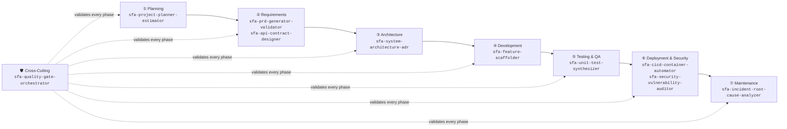
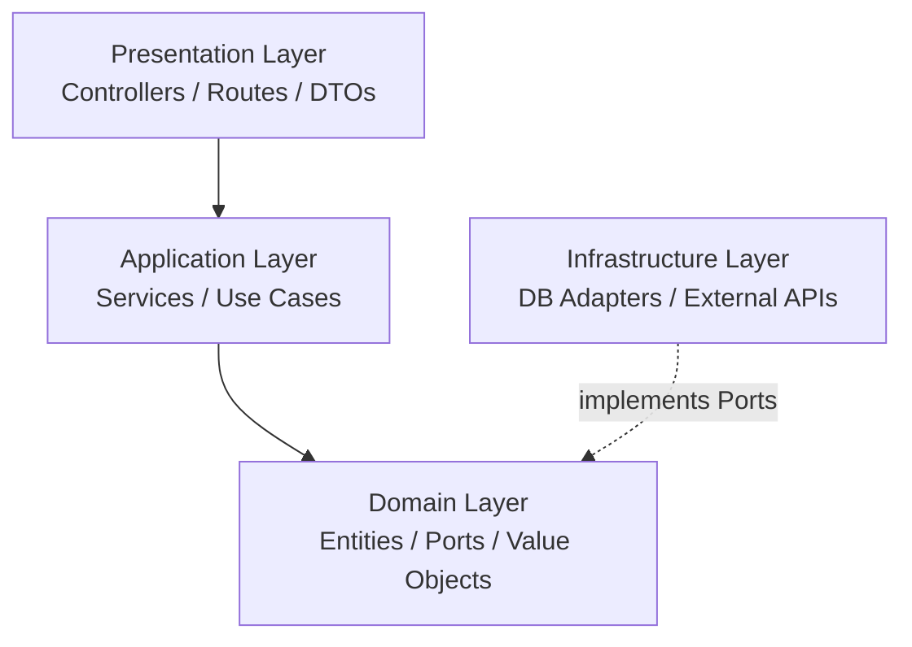
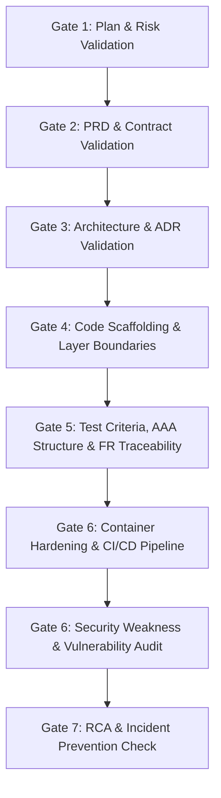
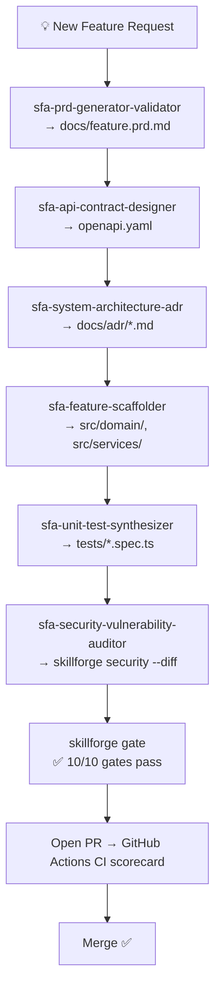

# SkillForgeAI — Getting Started Guide

> **SkillForgeAI** is an enterprise-grade framework of specialized **Agent Skills** that equips AI coding assistants — Antigravity, Cursor, Claude Code, Windsurf, OpenCode, and VSCode Copilot — with structured, phase-locked, and verified capabilities across all **7 phases of the Software Development Life Cycle (SDLC)**.

---

## Table of Contents

1. [What Is SkillForgeAI?](#1-what-is-skillforgeai)
2. [Prerequisites](#2-prerequisites)
3. [The 7-Phase SDLC Architecture](#3-the-7-phase-sdlc-architecture)
4. [Path A — Brand-New Project](#4-path-a--brand-new-project)
5. [Path B — Adopting Into an Existing Repo](#5-path-b--adopting-into-an-existing-repo)
6. [The 10 SDLC Skills — Reference Card](#6-the-10-sdlc-skills--reference-card)
7. [The Quality Gate System](#7-the-quality-gate-system)
8. [The `skillforge` CLI — Full Command Reference](#8-the-skillforge-cli--full-command-reference)
9. [Monorepo Domain Slicing](#9-monorepo-domain-slicing)
10. [Multi-Editor Sync](#10-multi-editor-sync)
11. [Daily Developer Workflow](#11-daily-developer-workflow)
12. [The 4 Golden Rules](#12-the-4-golden-rules)
13. [Verified Reference Examples](#13-verified-reference-examples)

---

## 1. What Is SkillForgeAI?

Most AI coding agents jump straight from a vague request to code — skipping requirements, skipping architecture, and producing untraceable, untested output.

**SkillForgeAI prevents this.** It installs structured, phase-locked *skills* into any AI coding agent, forcing every feature to travel through a verified SDLC pipeline:

```
Idea → Plan → PRD → API Contract → Architecture → Code → Tests → CI/CD → Maintenance
```

Each phase has:
- A dedicated **Skill** that instructs the AI agent exactly what to produce
- A **validation script** that checks the deliverable automatically
- A **Quality Gate** that blocks progression if standards aren't met

> [!IMPORTANT]
> SkillForgeAI is **language-agnostic** and **editor-agnostic**. It works with TypeScript, C#/.NET, Python, Go, and Java/Kotlin — and syncs to Antigravity, Cursor, Claude Code, Windsurf, OpenCode, and VSCode automatically.

---

## 2. Prerequisites

| Requirement | Minimum Version | Purpose |
|:---|:---|:---|
| **Node.js** | v22+ | Runs the `skillforge` CLI and all validation scripts |
| **.NET SDK** | 10 (optional) | Required only if using the C# / .NET examples or scaffolder |
| **Git** | Any | Required for the `diff` and `signoff` commands |
| **An AI Coding Agent** | — | Antigravity, Cursor, Claude Code, Windsurf, OpenCode, or VSCode Copilot |

```bash
# Verify prerequisites
node --version    # Should be v22+
git --version
dotnet --version  # Optional — only for .NET projects
```

---

## 3. The 7-Phase SDLC Architecture



> [!NOTE]
> The `sfa-quality-gate-orchestrator` is a cross-cutting skill — it runs automated validation scripts at **every phase transition**, preventing you from progressing with incomplete or non-conforming artifacts.

---

## 4. Path A — Brand-New Project

Follow these steps in sequence. Never skip a phase.

### Step 1 — Clone & Initialize

```bash
# Clone SkillForgeAI as your project foundation
git clone https://github.com/way2solutions/SkillForgeAI my-new-project
cd my-new-project

# Initialize environment (installs git hooks, validates Node version)
node bin/skillforge.mjs init

# Sync agent instruction files for all editors
node bin/skillforge.mjs sync
```

The `sync` command auto-generates:

| File Generated | Target Editor |
|:---|:---|
| `AGENTS.md` | Antigravity |
| `CLAUDE.md` | Claude Code |
| `.cursorrules` | Cursor IDE |
| `.windsurfrules` | Windsurf |
| `OPENCODE.md` | OpenCode |
| `.vscode/tasks.json` | VSCode Tasks |
| `.github/copilot-instructions.md` | GitHub Copilot |
| `.clinerules` | Cline / Roo |

---

### Step 2 — Phase 1: Plan the Project

**Skill:** `sfa-project-planner-estimator`

**Prompt your AI agent:**
> *"Use the sfa-project-planner-estimator skill to create a project plan for [your app / feature idea]."*

**What the agent produces:**
- Work Breakdown Structure (WBS) with milestones
- T-shirt / story-point effort estimates
- Risk register with mitigation strategies
- Validated via `validate-plan.mjs`

**Output location:** `docs/plan.md`

---

### Step 3 — Phase 2: Write Requirements (PRD)

**Skill:** `sfa-prd-generator-validator`

> [!IMPORTANT]
> This is the most critical step. All future tests, code, and architecture decisions trace back to this document. Never write code without an approved PRD.

**Prompt your AI agent:**
> *"Use the sfa-prd-generator-validator skill to convert this idea into a PRD: [describe your feature]."*

**The agent will:**
1. Ask targeted clarifying questions (scope, auth mechanism, database, scale, out-of-scope items)
2. Draft a structured PRD with numbered requirements
3. Auto-validate with `validate-prd.mjs`

**PRD structure produced:**

| Section | Example |
|:---|:---|
| Functional Requirements | `FR-001`: Create Order — System creates a new order in `PENDING` state |
| Non-Functional Requirements | `NFR-001`: In-memory latency < 10ms |
| Edge Cases | `EC-001`: Reject duplicate order with `409 Conflict` |
| Acceptance Criteria | Given-When-Then BDD scenarios |

**Output location:** `docs/<feature-name>.prd.md`

See the reference example: [`examples/order-service/order-service.prd.md`](examples/order-service/order-service.prd.md)

---

### Step 4 — Phase 2/3: Design API Contracts

**Skill:** `sfa-api-contract-designer`

**Prompt your AI agent:**
> *"Use the sfa-api-contract-designer skill to draft an OpenAPI 3.1 contract from the approved PRD."*

**What the agent produces:**
- Full OpenAPI 3.1 YAML with typed request/response schemas
- RFC 7807 Problem Details for all error responses (`400`, `401`, `404`, `409`, `500`)
- Security schemes (Bearer JWT, API Key)
- Idempotency headers (`Idempotency-Key`, `X-Request-Id`)
- Validated via `validate-openapi.mjs`

> [!TIP]
> The API contract is the **shared source of truth** between the backend agent (scaffolder) and frontend/test agents. Lock it down before writing any implementation code.

---

### Step 5 — Phase 3: Architecture & ADRs

**Skill:** `sfa-system-architecture-adr`

**Prompt your AI agent:**
> *"Use the sfa-system-architecture-adr skill to generate C4 diagrams and Architecture Decision Records for this system."*

**What the agent produces:**
- **C4 Context Diagram** — actors, users, external systems
- **C4 Container Diagram** — services, databases, caches, queues
- **ADR files** in `docs/adr/ADR-0001-[title].md` for every major decision (database, auth mechanism, caching strategy)
- Validated via `validate-architecture.mjs`

**ADR structure:**

```
docs/adr/
├── ADR-0001-database-choice.md       # Context, Decision, Consequences
├── ADR-0002-auth-mechanism.md
└── ADR-0003-caching-strategy.md
```

---

### Step 6 — Phase 4: Scaffold Code

**Skill:** `sfa-feature-scaffolder`
**CLI:** `node bin/skillforge.mjs scaffold`

```bash
# TypeScript / Node.js — Vertical Slice / Layered Architecture
node bin/skillforge.mjs scaffold --name "order" --lang "ts"

# C# / .NET 10 — Clean Architecture
node bin/skillforge.mjs scaffold --name "order" --lang "dotnet"
```

Or prompt your AI agent:
> *"Use the sfa-feature-scaffolder skill to scaffold the order domain from the approved PRD."*

**Architecture enforced:**



> [!CAUTION]
> **Domain entities MUST NOT import database drivers, ORMs, or web framework packages.** The quality gate will fail if this boundary is violated.

**TypeScript output structure:**
```
src/
├── domain/
│   ├── entities/order.entity.ts        # Pure business logic, no external deps
│   └── ports/order-repository.port.ts  # Interface / abstract port
├── services/order.service.ts           # Application use-case orchestration
└── repositories/order.repository.ts    # Infrastructure adapter (implements port)
```

---

### Step 7 — Phase 5: Synthesize Tests

**Skill:** `sfa-unit-test-synthesizer`

**Prompt your AI agent:**
> *"Use the sfa-unit-test-synthesizer skill to generate a full test suite for the order service. Cite FR-001, FR-002, EC-001 from the PRD."*

**Test matrix produced:**

| Category | Coverage |
|:---|:---|
| Happy Path | Valid inputs → expected state transitions |
| Boundary Conditions | Empty strings, min/max values, zero quantities |
| Negative / Error Cases | Missing fields, domain rule violations, duplicate entities |
| Idempotency | Calling the same operation twice verifies state integrity |

**Every test must cite a requirement ID:**

```typescript
it('should create order in PENDING state (FR-001)', async () => {
  // Arrange
  const repo = new InMemoryOrderRepository();
  const service = new OrderService(repo);

  // Act
  const order = await service.createOrder({ items: [{ sku: 'ABC', qty: 2 }] });

  // Assert
  expect(order.status).toBe('PENDING');
});
```

---

### Step 8 — Phase 6: Container & CI/CD

**Skill:** `sfa-cicd-container-automator`

**Prompt your AI agent:**
> *"Use the sfa-cicd-container-automator skill to create a hardened Dockerfile and GitHub Actions CI pipeline."*

**What the agent produces:**
- **Multi-stage Dockerfile** with Alpine/Slim base, build stage, and non-root runner stage
- **`.dockerignore`** excluding `.env*`, `node_modules`, `tests`, `.git`
- **GitHub Actions workflow** (lint → test → build → scan → deploy)
- Validated via `validate-ci-container.mjs`

---

### Step 9 — Phase 6: Security & Vulnerability Audit

**Skill:** `sfa-security-vulnerability-auditor`
**CLI:** `node bin/skillforge.mjs security`

**Prompt your AI agent:**
> *"Use the sfa-security-vulnerability-auditor skill to audit code changes and application source for vulnerabilities, leaked secrets, and OWASP Top 10 / CWE weaknesses."*

```bash
# Audit full application workspace
node bin/skillforge.mjs security

# Audit only uncommitted Git diff changes (pre-commit / PR)
node bin/skillforge.mjs security --diff

# Audit specific directory
node bin/skillforge.mjs security --path "src/"
```

**What the agent verifies:**
- No leaked private keys, AWS tokens, GitHub PATs, or JWT secrets (`CWE-798`)
- Parameterized queries protecting against SQL Injection (`CWE-89`)
- Safe execution avoiding OS Command Injection (`CWE-78`) and Code Injection (`CWE-94`)
- Secure path handling preventing Path Traversal (`CWE-22`)
- Modern cryptography (`SHA-256`, Argon2) instead of broken algorithms (`MD5`, `SHA-1`)
- Production hardening: TLS validation active, strict CORS without wildcard credentials

---

### Step 10 — Run Quality Gate Before Every PR

```bash
# Run all 10 SDLC quality gates
node bin/skillforge.mjs gate

# Check a specific phase only
node bin/skillforge.mjs gate --phase 6

# Output JSON for CI tooling
node bin/skillforge.mjs gate --json
```

> [!CAUTION]
> Never merge a PR without all 10 gates passing. The included GitHub Actions bot (`.github/workflows/skillforge-gate.yml`) automatically blocks merges if any gate fails.

#### Configure which artifacts each gate validates

Gates read `skillforge.config.json` at the repo root. Copy [`skillforge.config.example.json`](skillforge.config.example.json) and point each key at your own artifacts:

```jsonc
{
  "version": 1,
  "mode": "project",
  "artifacts": {
    "plan": "docs/plan.md",
    "prd": "docs/**/*.prd.md",
    "openapi": "openapi.yaml",
    "architecture": "docs/ARCHITECTURE.md",
    "signoff": "docs/approvals/*.md",
    "src": "src",
    "tests": "tests",
    "dockerfile": "Dockerfile",
    "rca": "docs/incidents/RCA-*.md"
  }
}
```

```bash
node bin/skillforge.mjs gate --config skillforge.config.json
node bin/skillforge.mjs gate --self-test      # validate the framework's own examples
node bin/skillforge.mjs gate --allow-missing  # report missing artifacts as SKIPPED
```

In `project` mode a missing **required** artifact fails the gate (fail closed) so a PR can never be certified against framework templates by accident.

---

## 5. Path B — Adopting Into an Existing Repo

You **don't need to start over.** SkillForgeAI overlays cleanly on any existing codebase in six steps.

### Step 1 — Overlay the Framework

```bash
# From inside your existing project root (Windows):
xcopy /E /I <path-to-SkillForgeAI>\.agents   .agents
xcopy /E /I <path-to-SkillForgeAI>\scripts   scripts
xcopy /E /I <path-to-SkillForgeAI>\bin       bin
xcopy /E /I <path-to-SkillForgeAI>\templates templates

# From inside your existing project root (macOS / Linux):
cp -r <path-to-SkillForgeAI>/.agents   .
cp -r <path-to-SkillForgeAI>/scripts   .
cp -r <path-to-SkillForgeAI>/bin       .
cp -r <path-to-SkillForgeAI>/templates .
```

Then add the npm scripts to your `package.json`:
```json
{
  "scripts": {
    "skillforge": "node bin/skillforge.mjs",
    "gate":       "node bin/skillforge.mjs gate",
    "security":   "node bin/skillforge.mjs security",
    "diff":       "node bin/skillforge.mjs diff",
    "graph":      "node bin/skillforge.mjs graph",
    "slice":      "node bin/skillforge.mjs slice",
    "scaffold":   "node bin/skillforge.mjs scaffold",
    "signoff":    "node bin/skillforge.mjs signoff",
    "heal":       "node bin/skillforge.mjs heal",
    "sync":       "node bin/skillforge.mjs sync"
  }
}
```

### Step 2 — Initialize & Sync

```bash
node bin/skillforge.mjs init   # Install git hooks and validate environment
node bin/skillforge.mjs sync   # Auto-generate all editor instruction files
```

### Step 3 — Baseline Audit: Find Your Red Gates

```bash
# Run all 10 gates and export a JSON baseline
node bin/skillforge.mjs gate --json > baseline-audit.json
```

This tells you exactly which SDLC phases are **failing** vs **passing**, giving you a prioritized remediation backlog.

### Step 4 — Map Existing Artifacts to SDLC Phases

| What you already have | SkillForgeAI equivalent | Remediation action |
|:---|:---|:---|
| Confluence doc / Jira ticket | Phase 2 PRD | Migrate to `.prd.md` via `sfa-prd-generator-validator` |
| Existing Swagger / OpenAPI file | Phase 2/3 Contract | Validate with `validate-openapi.mjs` |
| Design doc / architecture diagram | Phase 3 ADR | Formalize with `sfa-system-architecture-adr` → `docs/adr/` |
| Existing source folders | Phase 4 Scaffold | Run `skillforge graph` to map it; refactor to Clean Architecture |
| Existing test files | Phase 5 Quality | Run `skillforge gate --phase 5` for AAA and `FR-XXX` traceability |
| Existing Dockerfile | Phase 6 Container | Run `skillforge gate --phase 6` to audit non-root, multi-stage hardening |
| Security configs / SAST scans | Phase 6 Security | Run `skillforge security` to audit secrets, SAST, and OWASP/CWE weaknesses |

### Step 5 — Generate a Code Graph of What Exists

```bash
# Understand your current codebase
node bin/skillforge.mjs graph
node bin/skillforge.mjs graph --format mermaid

# For large monorepos: partition into focused domain slices
node bin/skillforge.mjs slice
node bin/skillforge.mjs slice --list
```

### Step 6 — Enable the GitHub Actions CI Bot

Copy `.github/workflows/skillforge-gate.yml` to your repo. On every PR it will:
1. Run all 10 quality gates
2. Post a detailed scorecard comment directly on the PR
3. Update the comment in-place (anti-spam)
4. **Block merging** if any gate fails

---

## 6. The 10 SDLC Skills — Reference Card

| Phase | Skill Name | Trigger Prompt | Key Output | Validator Script |
|:---|:---|:---|:---|:---|
| **Phase 1** | `sfa-project-planner-estimator` | *"Use sfa-project-planner-estimator to plan [feature]"* | `docs/plan.md` (WBS, milestones, risks) | `validate-plan.mjs` |
| **Phase 2** | `sfa-prd-generator-validator` | *"Use sfa-prd-generator-validator to write a PRD for [feature]"* | `docs/<feature>.prd.md` with `FR-XXX`, `EC-XXX` | `validate-prd.mjs` |
| **Phase 2/3** | `sfa-api-contract-designer` | *"Use sfa-api-contract-designer to design the API contract from the PRD"* | `openapi.yaml` (OpenAPI 3.1 + RFC 7807) | `validate-openapi.mjs` |
| **Phase 3** | `sfa-system-architecture-adr` | *"Use sfa-system-architecture-adr to generate C4 diagrams and ADRs"* | `ARCHITECTURE.md`, `docs/adr/*.md` | `validate-architecture.mjs` |
| **Phase 4** | `sfa-feature-scaffolder` | *"Use sfa-feature-scaffolder to scaffold the [domain] feature"* | `src/domain/`, `src/services/`, `src/repositories/` | `verify-scaffold.mjs` |
| **Phase 5** | `sfa-unit-test-synthesizer` | *"Use sfa-unit-test-synthesizer to write tests citing FR-001, EC-001"* | `tests/*.spec.ts` or `*Tests.cs` (AAA pattern) | `verify-coverage-criteria.mjs` |
| **Phase 6** | `sfa-cicd-container-automator` | *"Use sfa-cicd-container-automator to create a Dockerfile and CI pipeline"* | `Dockerfile`, `.github/workflows/*.yml` | `validate-ci-container.mjs` |
| **Phase 6** | `sfa-security-vulnerability-auditor` | *"Use sfa-security-vulnerability-auditor to audit changes and app for OWASP/CWE flaws"* | `docs/security/audit-report.md`, threat matrix | `audit-security.mjs` |
| **Phase 7** | `sfa-incident-root-cause-analyzer` | *"Use sfa-incident-root-cause-analyzer to diagnose this error: [stack trace]"* | `docs/incidents/RCA-*.md`, regression test | `validate-rca.mjs` |
| **Cross-Cutting** | `sfa-quality-gate-orchestrator` | *(runs automatically via CLI)* | Gate pass/fail report | `run-all-gates.mjs` |

---

## 7. The Quality Gate System

The `sfa-quality-gate-orchestrator` runs **10 automated gates** that map to SDLC phase transitions:

> **Fail-closed by design:** If the gate report is missing or unparseable (e.g., a crashed gate run), the PR scorecard reports `MISSING` and blocks merge — it never assumes success.



### Sample PR Scorecard Output (GitHub Actions)

```
🛡️ SkillForgeAI Quality Gate Report

> Status: ✅ ALL 10 SDLC QUALITY GATES PASSED
> Recommended SemVer Bump: PATCH | Gates Evaluated: 10/10 Passing

| SDLC Phase | Gate Name                            | Status     |
|:-----------|:-------------------------------------|:-----------|
| Phase 1    | Planning & Feasibility               | ✅ PASSED  |
| Phase 2    | Requirements Analysis (PRD)          | ✅ PASSED  |
| Phase 2    | API Contract (OpenAPI)               | ✅ PASSED  |
| Phase 3    | Architecture & ADRs                  | ✅ PASSED  |
| Phase 3→4  | Human-in-the-Loop (HITL) Sign-Off    | ✅ PASSED  |
| Phase 4    | Code Scaffolding Boundaries          | ✅ PASSED  |
| Phase 5    | Test Criteria & AAA Structure        | ✅ PASSED  |
| Phase 6    | Container Hardening & CI/CD          | ✅ PASSED  |
| Phase 6    | Security Weakness & Vulnerability Audit | ✅ PASSED  |
| Phase 7    | Maintenance & Incident RCA           | ✅ PASSED  |
```

---

## 8. The `skillforge` CLI — Full Command Reference

```bash
# ── Quality Gates ─────────────────────────────────────────────────
node bin/skillforge.mjs gate                     # Run all 10 SDLC gates
node bin/skillforge.mjs gate --phase 6           # Run a specific phase gate
node bin/skillforge.mjs gate --json              # Output JSON for CI tooling

# ── Security & Vulnerability Audit ────────────────────────────────
node bin/skillforge.mjs security                 # Audit workspace for secrets & CWEs
node bin/skillforge.mjs security --diff          # Audit uncommitted Git changes
node bin/skillforge.mjs security --staged        # Audit staged changes only
node bin/skillforge.mjs security --path "src/"   # Audit specific directory or file
node bin/skillforge.mjs security --strict        # Fail on medium/low warnings

# ── Breaking Change & SemVer Analysis ─────────────────────────────
node bin/skillforge.mjs diff                     # Compare working tree vs HEAD
node bin/skillforge.mjs diff --staged            # Compare staged changes only

# ── Code Graph & Symbol Map ────────────────────────────────────────
node bin/skillforge.mjs graph                    # Generate REPO-MAP.md
node bin/skillforge.mjs graph --format mermaid   # Output as Mermaid diagram

# ── Clean Architecture Scaffolder ─────────────────────────────────
node bin/skillforge.mjs scaffold --name "order" --lang "ts"      # TypeScript
node bin/skillforge.mjs scaffold --name "order" --lang "dotnet"  # C# .NET 10

# ── Monorepo Domain Slicing ────────────────────────────────────────
node bin/skillforge.mjs slice                         # Generate all slice maps
node bin/skillforge.mjs slice --list                  # List slices with token counts
node bin/skillforge.mjs slice --name "order-service"  # Inspect one slice

# ── HITL Sign-Off Draft & Verification ────────────────────────────
# Generates a PENDING_REVIEW draft only (never self-approves).
node bin/skillforge.mjs signoff --feature "order-service" --by "Lead Architect"
# A human sets Status: APPROVED, checks the boxes, and commits with `git commit -S`.
# Verification requires an allow-listed, non-agent author and a signed commit.
node bin/skillforge.mjs signoff --verify docs/approvals/order-service-signoff.md

# ── Automated Self-Healing Loop ───────────────────────────────────
node bin/skillforge.mjs heal                     # Auto-fix failing tests in a loop

# ── Environment & Editor Sync ─────────────────────────────────────
node bin/skillforge.mjs init                     # Initialize environment & git hooks
node bin/skillforge.mjs sync                     # Regenerate all editor config files

# ── MCP Server (Cursor, Claude Desktop, Antigravity) ─────────────
node bin/skillforge.mjs mcp                      # Start the MCP server
```

> [!TIP]
> All commands are also available as `npm run <command>` (e.g. `npm run gate`, `npm run diff`) when the scripts are added to your `package.json`.

---

## 9. Monorepo Domain Slicing

In large enterprise codebases (10,000+ files), loading a full `REPO-MAP.md` burns tens of thousands of AI tokens. SkillForgeAI partitions the codebase into **focused domain slice maps**:

```
docs/context/
├── REPO-MAP.md                      # Full monolithic map (~935 tokens)
├── code-graph.json                  # Symbol-level AST dependency graph
└── slices/
    ├── index.md                     # Slice router — agents load this first
    ├── slices.json                  # Machine-readable registry
    ├── order-service-map.md         # Focused slice (~234 tokens)
    ├── dotnet-order-service-map.md  # C# .NET slice (~278 tokens)
    └── cli-map.md                   # CLI module slice (~347 tokens)
```

**Result: 65–98% token reduction** — an agent working on "Order Processing" loads the 234-token slice map instead of the full 935-token repo map.

```bash
# Generate or refresh all slice maps
node bin/skillforge.mjs slice

# Show slice list with token savings
node bin/skillforge.mjs slice --list

# Focus agent context on one domain
node bin/skillforge.mjs slice --name "order-service"
```

The MCP server also exposes `list_domain_slices` and `get_domain_slice` tools for Cursor, Claude Desktop, and Antigravity.

---

## 10. Multi-Editor Sync

A single command keeps **all editors in sync** from one source of truth:

```bash
node bin/skillforge.mjs sync
```

| Editor | Config File | Features |
|:---|:---|:---|
| **Antigravity** | `AGENTS.md` | Native skill discovery, phase constraints |
| **Cursor IDE** | `.cursorrules` | Chat and Composer constraints |
| **Claude Code** | `CLAUDE.md` | Terminal assistant instructions |
| **Windsurf** | `.windsurfrules` | Cascade flow enforcement |
| **OpenCode** | `OPENCODE.md` + `.opencode/` | Skill discovery and verification |
| **VSCode Copilot** | `.github/copilot-instructions.md` | Copilot Chat SDLC guidance |
| **VSCode Cline / Roo** | `.clinerules` | Autonomous loop phase constraints |
| **VSCode Tasks** | `.vscode/tasks.json` | GUI tasks (`Ctrl+Shift+B`) |

---

## 11. Daily Developer Workflow



### Recommended Agent Interaction Pattern

For every new feature, use this sequence of agent prompts:

```
1. "Use the sfa-project-planner-estimator skill to plan [feature]."
2. "Use the sfa-prd-generator-validator skill to write a PRD for [feature]."
3. "Use the sfa-api-contract-designer skill to design the API from the PRD."
4. "Use the sfa-system-architecture-adr skill to generate C4 diagrams and ADRs."
5. "Use the sfa-feature-scaffolder skill to scaffold the [domain] from the PRD."
6. "Use the sfa-unit-test-synthesizer skill to write tests citing all FR-XXX and EC-XXX."
7. "Use the sfa-security-vulnerability-auditor skill to audit changes: node bin/skillforge.mjs security --diff"
8. "Run the quality gate: node bin/skillforge.mjs gate"
```

### Maintenance Workflow (Phase 7)

When a production incident occurs:

```
1. "Use the sfa-incident-root-cause-analyzer skill to diagnose this error: [paste stack trace]."
2. Agent writes a failing regression test → confirms it reproduces the bug
3. Agent applies the minimal hotfix → confirms all tests pass
4. Agent drafts the RCA post-mortem in docs/incidents/RCA-YYYY-MM-DD-[title].md
5. node bin/skillforge.mjs gate  ← verify all gates still pass after the fix
```

---

## 12. The 4 Golden Rules

> [!CAUTION]
> These are enforced by the automated quality gates. Breaking any of them causes the CI bot to block your PR.

### Rule 1: Never Guess Requirements
Always run `sfa-prd-generator-validator` first for any new feature. Never start coding from a vague prompt.

### Rule 2: Enforce Architecture Boundaries
Domain entities and business logic **MUST NOT** import database drivers, ORMs, web frameworks, or infrastructure packages. Dependency flows inward only:
```
Infrastructure → Application → Domain   ✅ Allowed
Domain → Infrastructure                 ❌ Gate fails
```

### Rule 3: Every Test Must Cite a Requirement
All test descriptions must reference a requirement ID from the PRD:
```typescript
it('should reject duplicate order with 409 Conflict (EC-001)', ...)   // ✅ Correct
it('should reject duplicate order', ...)                               // ❌ Gate fails
```

### Rule 4: Gate Before Every PR
Run `node bin/skillforge.mjs gate` and pass all 10 gates before opening any pull request. The GitHub Actions CI bot enforces this automatically — it comments a scorecard on every PR and blocks merging on failure.

---

## 13. Verified Reference Examples

Two complete, working examples are included in the repo:

### TypeScript Order Processing Service

**Location:** [`examples/order-service/`](examples/order-service/)

```
examples/order-service/
├── order-service.prd.md           ← Approved PRD (FR-001, FR-002, FR-003, EC-001)
├── src/
│   ├── domain/entities/           ← Pure TypeScript domain entity (zero external deps)
│   ├── services/order.service.ts  ← Application use-case orchestration
│   └── repositories/              ← In-memory adapter implementing the port
└── tests/order.service.spec.ts    ← 100% passing AAA tests with FR/EC citations
```

```bash
# Run TypeScript tests
node --experimental-strip-types --test examples/order-service/tests/order.service.spec.ts
```

### C# / .NET 10 Clean Architecture Order Service

**Location:** [`examples/dotnet-order-service/`](examples/dotnet-order-service/)

```
examples/dotnet-order-service/
├── src/
│   ├── Domain/Entities/Order.cs                        ← C# 13 entity, zero external deps
│   ├── Domain/Ports/IOrderRepository.cs                ← Abstract repository port
│   ├── Application/Services/OrderService.cs            ← Business orchestration
│   └── Infrastructure/Persistence/InMemoryOrderRepo.cs ← Adapter
└── tests/OrderService.Tests/OrderServiceTests.cs       ← xUnit tests (100% pass, 21ms)
```

```bash
# Run .NET 10 tests
dotnet run --project examples/dotnet-order-service/tests/OrderService.Tests/OrderService.Tests.csproj
```

---

## Quick Reference: Where Things Live

```
SkillForgeAI/
├── .agents/skills/                  ← All 10 SDLC skill instruction files (SKILL.md)
│   ├── sfa-prd-generator-validator/
│   ├── sfa-api-contract-designer/
│   ├── sfa-system-architecture-adr/
│   ├── sfa-feature-scaffolder/
│   ├── sfa-unit-test-synthesizer/
│   ├── sfa-cicd-container-automator/
│   ├── sfa-security-vulnerability-auditor/
│   ├── sfa-incident-root-cause-analyzer/
│   ├── sfa-project-planner-estimator/
│   └── sfa-quality-gate-orchestrator/
├── bin/skillforge.mjs               ← Unified CLI entry point
├── scripts/                         ← Editor sync, code graph, PR scorecard, self-heal
├── templates/                       ← Phase sign-off template
├── docs/context/                    ← REPO-MAP.md and domain slice maps
├── examples/                        ← Verified TypeScript and .NET reference implementations
├── .github/workflows/               ← skillforge-gate.yml CI bot for PRs
├── AGENTS.md                        ← Antigravity agent instructions (auto-generated)
├── CLAUDE.md                        ← Claude Code instructions (auto-generated)
├── .cursorrules                     ← Cursor IDE rules (auto-generated)
└── package.json                     ← npm scripts for all CLI commands
```
