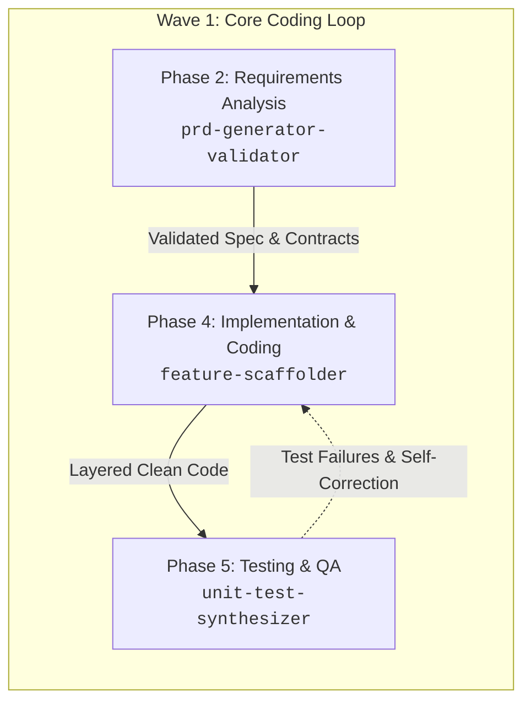

# SkillForgeAI: Autonomous SDLC Skills for Coding Agents

**SkillForgeAI** is a modular framework of specialized **Agent Skills** designed to equip AI coding assistants (such as Antigravity, Claude Code, Cursor, and Copilot Workspace) with structured, reliable software engineering capabilities across the Software Development Life Cycle (SDLC).

---

## 🚀 Wave 1: Core Coding Loop (Immediate ROI)

Wave 1 implements the tight **Inner Dev Loop** across three foundational phases of the SDLC:



---

## 📦 Installed Skills in Wave 1

| Skill Name | SDLC Phase | Purpose | Location |
| :--- | :--- | :--- | :--- |
| **`prd-generator-validator`** | **Phase 2: Requirements Analysis** | Transforms ambiguous user ideas into structured PRDs with numbered requirements (`FR-XXX`), edge cases (`EC-XXX`), and BDD acceptance criteria. | [`.agents/skills/prd-generator-validator/`](.agents/skills/prd-generator-validator/SKILL.md) |
| **`feature-scaffolder`** | **Phase 4: Implementation / Coding** | Scaffolds domain models, repository ports, services, and DTOs adhering to Clean / Layered Architecture. | [`.agents/skills/feature-scaffolder/`](.agents/skills/feature-scaffolder/SKILL.md) |
| **`unit-test-synthesizer`** | **Phase 5: Testing & QA** | Generates isolated, deterministic unit tests following Arrange-Act-Assert (AAA) with direct traceability back to the PRD. | [`.agents/skills/unit-test-synthesizer/`](.agents/skills/unit-test-synthesizer/SKILL.md) |

---

## 🛠️ Verification & Quality Assurance Scripts

Every skill in Wave 1 includes an automated validator script to guarantee quality at each transition:

```bash
# 1. Validate PRD completeness (Phase 2 -> Phase 4 gate)
node .agents/skills/prd-generator-validator/scripts/validate-prd.mjs <path-to-prd.md>

# 2. Verify architecture boundaries (Phase 4 -> Phase 5 gate)
node .agents/skills/feature-scaffolder/scripts/verify-scaffold.mjs <path-to-src-folder>

# 3. Verify unit test suite criteria (Phase 5 completion gate)
node .agents/skills/unit-test-synthesizer/scripts/verify-coverage-criteria.mjs <path-to-test-file-or-dir>
```

---

## 🧪 Verified Example: Order Processing Service

A complete reference implementation built with Wave 1 skills is available in [`examples/order-service/`](examples/order-service/):

1. **Specification:** [`examples/order-service/order-service.prd.md`](examples/order-service/order-service.prd.md)
2. **Implementation:**
   - Domain Entity: [`examples/order-service/src/domain/entities/order.entity.ts`](examples/order-service/src/domain/entities/order.entity.ts)
   - Repository Port: [`examples/order-service/src/domain/ports/order.repository.ts`](examples/order-service/src/domain/ports/order.repository.ts)
   - Application Service: [`examples/order-service/src/services/order.service.ts`](examples/order-service/src/services/order.service.ts)
   - In-Memory Fake: [`examples/order-service/src/repositories/in-memory-order.repository.ts`](examples/order-service/src/repositories/in-memory-order.repository.ts)
3. **Unit Tests:** [`examples/order-service/tests/order.service.spec.ts`](examples/order-service/tests/order.service.spec.ts)

### Running the Example
```bash
# Run unit tests natively with Node.js
node --experimental-strip-types --test examples/order-service/tests/order.service.spec.ts
```

---

## 🗺️ Next Waves (Roadmap)

- **Wave 2: Architecture & Delivery**
  - Phase 2/3: `contract-first-designer` (OpenAPI, Protobuf)
  - Phase 3: `system-architecture-adr` (ADRs, C4 diagrams)
  - Phase 6: `cicd-pipeline-automator` & `container-iac-scaffolder`
- **Wave 3: Hardening & Operations**
  - Phase 3/5: `threat-modeling-security` & `security-sast-auditor`
  - Phase 7: `telemetry-observability` & `incident-root-cause-analyzer`
