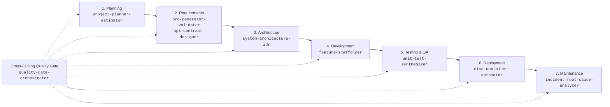

# SkillForgeAI: Autonomous SDLC Skills for Coding Agents

**SkillForgeAI** is an enterprise-grade framework of specialized **Agent Skills** designed to equip AI coding assistants (Antigravity, Cursor, Claude Code, VSCode, OpenCode, Windsurf) with structured, reliable, and verified capabilities across all **7 phases of the Software Development Life Cycle (SDLC)**.

---

## 🏛️ The 7-Phase SDLC Skills Architecture



---

## 🌐 Polyglot Language & Database Support

SkillForgeAI is **language-agnostic** and **database-agnostic**. The core skills enforce Clean Architecture (Ports & Adapters), decoupling business logic from any specific programming language, framework, or persistence engine.

### Supported Programming Languages

| Language / Platform | Architecture Pattern (`feature-scaffolder`) | Test Framework (`unit-test-synthesizer`) | Native Build & Test Command |
| :--- | :--- | :--- | :--- |
| **C# / .NET** (8 / 9) | Clean Architecture (`Domain`, `Application`, `Infrastructure`, `WebApi`) | `xUnit` or `NUnit` with `Moq` | `dotnet test` |
| **TypeScript / Node** | Vertical Slice / Layered (`domain`, `services`, `repositories`) | `Vitest`, `Jest`, or `node:test` | `npm test` |
| **Python** (FastAPI / Django) | Ports & Adapters with `Pydantic` models & Protocols | `pytest` with `pytest-mock` | `pytest` |
| **Go (Golang)** | Modular packages (`internal/domain`, `internal/service`) | Native `go test` (table-driven) | `go test ./...` |
| **Java / Kotlin** (Spring Boot) | Hexagonal Architecture (`domain.model`, `domain.port`) | `JUnit 5` with `Mockito` | `mvn test` / `gradle test` |

### Supported Databases & Persistence Engines

Because all data access is abstracted behind domain repository ports, any storage engine can be plugged in without mutating core business rules:

* **Relational / SQL:** PostgreSQL, Microsoft SQL Server, MySQL, SQLite, Oracle
* **NoSQL & Document:** MongoDB, DynamoDB, Azure Cosmos DB, Couchbase
* **In-Memory & Caching:** Redis, Memcached, Valkey
* **Vector & Search:** pgvector, Pinecone, Qdrant, Elasticsearch

### Build Tool Auto-Detection

The quality gate runner (`run-all-gates.mjs`) inspects the workspace root and automatically delegates to the native runner:
- `*.csproj` / `*.sln` $\rightarrow$ `dotnet test`
- `pyproject.toml` / `requirements.txt` $\rightarrow$ `pytest`
- `package.json` $\rightarrow$ `npm test`
- `go.mod` $\rightarrow$ `go test ./...`
- `pom.xml` $\rightarrow$ `mvn test`

---

## 📦 Installed Skills Catalog

| SDLC Phase | Skill Name | Role & Responsibility | Location |
| :--- | :--- | :--- | :--- |
| **Phase 1: Planning** | **`project-planner-estimator`** | WBS, sprint milestones, complexity estimation, and risk mitigation registers. | [`.agents/skills/project-planner-estimator/`](.agents/skills/project-planner-estimator/SKILL.md) |
| **Phase 2: Requirements** | **`prd-generator-validator`** | Converts user ideas into unambiguous PRDs with numbered requirements (`FR-XXX`), edge cases (`EC-XXX`), and BDD criteria. | [`.agents/skills/prd-generator-validator/`](.agents/skills/prd-generator-validator/SKILL.md) |
| **Phase 2/3: Contracts** | **`api-contract-designer`** | Drafts OpenAPI 3.1 specifications, RFC 7807 problem details, and security schemas before coding. | [`.agents/skills/api-contract-designer/`](.agents/skills/api-contract-designer/SKILL.md) |
| **Phase 3: Architecture** | **`system-architecture-adr`** | Generates C4 Context & Container diagrams, defines layer boundaries, and records ADRs. | [`.agents/skills/system-architecture-adr/`](.agents/skills/system-architecture-adr/SKILL.md) |
| **Phase 4: Development** | **`feature-scaffolder`** | Scaffolds Clean / Layered Architecture (Domain Entities $\rightarrow$ Port Interfaces $\rightarrow$ Application Services). | [`.agents/skills/feature-scaffolder/`](.agents/skills/feature-scaffolder/SKILL.md) |
| **Phase 5: Testing & QA** | **`unit-test-synthesizer`** | Generates deterministic, isolated unit tests following AAA pattern with in-memory fakes. | [`.agents/skills/unit-test-synthesizer/`](.agents/skills/unit-test-synthesizer/SKILL.md) |
| **Phase 6: Deployment** | **`cicd-container-automator`** | Multi-stage, hardened Dockerfiles (non-root runner) and GitHub Actions CI pipelines. | [`.agents/skills/cicd-container-automator/`](.agents/skills/cicd-container-automator/SKILL.md) |
| **Phase 7: Maintenance** | **`incident-root-cause-analyzer`** | Diagnoses production errors, synthesizes reproduction regression tests, and authors 5-Whys post-mortems. | [`.agents/skills/incident-root-cause-analyzer/`](.agents/skills/incident-root-cause-analyzer/SKILL.md) |
| **Cross-Cutting** | **`quality-gate-orchestrator`** | Automated verification runner that evaluates gates across all 7 phases. | [`.agents/skills/quality-gate-orchestrator/`](.agents/skills/quality-gate-orchestrator/SKILL.md) |

---

## 🛠️ Multi-Editor Support & Universal Bridge

SkillForgeAI automatically syncs across all major agentic editors from a single source of truth:

```bash
# Sync all editor configs in one command
node scripts/sync-editors.mjs
```

| Code Editor / Tool | Configuration File Generated | Supported Workflow |
| :--- | :--- | :--- |
| **VSCode (Native)** | [`.vscode/tasks.json`](.vscode/tasks.json) | GUI tasks (`Ctrl+Shift+B`) for quality gates, code graphs, and diffs. |
| **VSCode (Copilot)** | [`.github/copilot-instructions.md`](.github/copilot-instructions.md) | Directs Copilot Chat to follow SDLC phase skills. |
| **VSCode (Cline / Roo)** | [`.clinerules`](.clinerules) | Enforces phase constraints on autonomous execution loops. |
| **OpenCode** | [`OPENCODE.md`](OPENCODE.md) & [`.opencode/`](.opencode/) | Discovers skills and verifies requirements. |
| **Antigravity** | [`AGENTS.md`](AGENTS.md) & [`.agents/skills/`](.agents/skills/) | Native skill discovery and progressive disclosure. |
| **Cursor IDE** | [`.cursorrules`](.cursorrules) | Directs Cursor Chat and Composer. |
| **Claude Code** | [`CLAUDE.md`](CLAUDE.md) | Directs the Anthropic terminal assistant. |
| **Windsurf** | [`.windsurfrules`](.windsurfrules) | Informs Cascade flows. |

---

## ⚡ Zero-Token Code Graph & Change Impact Tracker

To prevent expensive and slow codebase rescanning when switching models or editors:

```bash
# 1. Generate persistent repository map & dependency graph (docs/context/REPO-MAP.md)
node scripts/generate-code-graph.mjs

# 2. Track git changes, affected downstream callers, and breaking changes
node scripts/detect-breaking-changes.mjs
```

---

## 🛡️ Automated Quality Gates

Every skill is guarded by an automated validation script. You can run all quality gates simultaneously or target a specific phase:

```bash
# Run all SDLC quality gates across the repository
node .agents/skills/quality-gate-orchestrator/scripts/run-all-gates.mjs

# Or test a single phase gate:
node .agents/skills/quality-gate-orchestrator/scripts/run-all-gates.mjs --phase 2
node .agents/skills/quality-gate-orchestrator/scripts/run-all-gates.mjs --phase 5
```

---

## 🧪 Verified Example: Order Processing Service

A complete end-to-end reference application demonstrating the full lifecycle is located in [`examples/order-service/`](examples/order-service/):

* **PRD:** [`examples/order-service/order-service.prd.md`](examples/order-service/order-service.prd.md)
* **Domain Entity:** [`examples/order-service/src/domain/entities/order.entity.ts`](examples/order-service/src/domain/entities/order.entity.ts)
* **Repository Port:** [`examples/order-service/src/domain/ports/order.repository.ts`](examples/order-service/src/domain/ports/order.repository.ts)
* **Application Service:** [`examples/order-service/src/services/order.service.ts`](examples/order-service/src/services/order.service.ts)
* **In-Memory Fake:** [`examples/order-service/src/repositories/in-memory-order.repository.ts`](examples/order-service/src/repositories/in-memory-order.repository.ts)
* **Unit Tests (100% Pass):** [`examples/order-service/tests/order.service.spec.ts`](examples/order-service/tests/order.service.spec.ts)

Run unit tests directly with Node.js:
```bash
node --experimental-strip-types --test examples/order-service/tests/order.service.spec.ts
```
