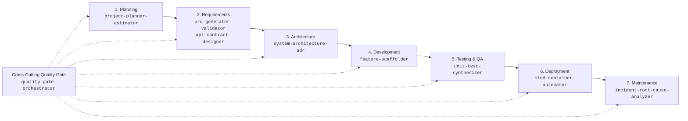

# SkillForgeAI: Autonomous SDLC Skills for Coding Agents

**SkillForgeAI** is an enterprise-grade framework of specialized **Agent Skills** designed to equip AI coding assistants (Antigravity, Cursor, Claude Code, VSCode, OpenCode, Windsurf) with structured, reliable, and verified capabilities across all **7 phases of the Software Development Life Cycle (SDLC)**.

---

## 🏛️ The 7-Phase SDLC Skills Architecture



---

## 💻 The Unified `skillforge` CLI

SkillForgeAI provides a unified, zero-dependency master CLI (`node bin/skillforge.mjs` or `skillforge`) for developers and coding agents:

```bash
# Run SDLC Quality Gates (All 9 gates or a specific phase)
node bin/skillforge.mjs gate
node bin/skillforge.mjs gate --phase 4
node bin/skillforge.mjs gate --json

# Semantic Breaking Change & SemVer Analysis
node bin/skillforge.mjs diff
node bin/skillforge.mjs diff --staged

# Symbol-Level Code Graph & Visual Mermaid Export
node bin/skillforge.mjs graph
node bin/skillforge.mjs graph --format mermaid

# Monorepo Domain Slicing (Scale to 10,000+ Files)
node bin/skillforge.mjs slice
node bin/skillforge.mjs slice --list
node bin/skillforge.mjs slice --name "order-service"

# Clean Architecture Scaffolder (.NET 10 & TypeScript)
node bin/skillforge.mjs scaffold --name "catalog" --lang "dotnet"
node bin/skillforge.mjs scaffold --name "billing" --lang "ts"

# Human-in-the-Loop (HITL) Sign-Off Generator & Gate
node bin/skillforge.mjs signoff --feature "order-service" --by "Lead Architect"

# Automated Self-Healing Test/Fix Loop
node bin/skillforge.mjs heal

# Environment Initialization & Editor Sync
node bin/skillforge.mjs init
node bin/skillforge.mjs sync
```

---

## 🌐 Polyglot Language & Database Support

SkillForgeAI is **language-agnostic** and **database-agnostic**. The core skills enforce **Clean Architecture (Ports & Adapters)** and **Vertical Slice Architecture**, decoupling business logic from any specific programming language, framework, or persistence engine while grouping cohesive domain features into self-contained slices.

### Supported Programming Languages

| Language / Platform | Architecture Pattern (`feature-scaffolder`) | Test Framework (`unit-test-synthesizer`) | Native Build & Test Command |
| :--- | :--- | :--- | :--- |
| **C# / .NET** (8 / 9 / 10) | Clean Architecture (`Domain`, `Application`, `Infrastructure`, `WebApi`) | `xUnit` (v2/v3) or `NUnit` with `Moq` | `dotnet run --project ...` / `dotnet test` |
| **TypeScript / Node** | Vertical Slice / Layered (`domain`, `services`, `repositories`) | `Vitest`, `Jest`, or `node:test` | `npm test` |
| **Python** (FastAPI / Django) | Ports & Adapters with `Pydantic` models & Protocols | `pytest` with `pytest-mock` | `pytest` |
| **Go (Golang)** | Modular packages (`internal/domain`, `internal/service`) | Native `go test` (table-driven) | `go test ./...` |
| **Java / Kotlin** (Spring Boot) | Hexagonal Architecture (`domain.model`, `domain.port`) | `JUnit 5` with `Mockito` | `mvn test` / `gradle test` |

### Supported Databases & Persistence Engines

Because all data access is abstracted behind domain repository ports, any storage engine can be plugged in without mutating core business rules:

* **Relational / SQL:** PostgreSQL, Microsoft SQL Server, MySQL, SQLite, Oracle
* **NoSQL & Document:** MongoDB, DynamoDB, Azure Cosmos DB, Couchbase
* **In-Memory & Caching:** Redis, Memcached, Valkey
* **Vector & Search:** pgvector, Pinecone, Qdrant, Elasticsearch

---

## 📦 Installed Skills Catalog

| SDLC Phase | Skill Name | Role & Responsibility | Location |
| :--- | :--- | :--- | :--- |
| **Phase 1: Planning** | **`project-planner-estimator`** | WBS, sprint milestones, complexity estimation, and risk mitigation registers. | [`.agents/skills/project-planner-estimator/`](.agents/skills/project-planner-estimator/SKILL.md) |
| **Phase 2: Requirements** | **`prd-generator-validator`** | Converts user ideas into unambiguous PRDs with numbered requirements (`FR-XXX`), edge cases (`EC-XXX`), and BDD criteria. | [`.agents/skills/prd-generator-validator/`](.agents/skills/prd-generator-validator/SKILL.md) |
| **Phase 2/3: Contracts** | **`api-contract-designer`** | Drafts OpenAPI 3.1 specifications, RFC 7807 problem details, and security schemas before coding. | [`.agents/skills/api-contract-designer/`](.agents/skills/api-contract-designer/SKILL.md) |
| **Phase 3: Architecture** | **`system-architecture-adr`** | Generates C4 Context & Container diagrams, defines layer boundaries, and records ADRs. | [`.agents/skills/system-architecture-adr/`](.agents/skills/system-architecture-adr/SKILL.md) |
| **Phase 4: Development** | **`feature-scaffolder`** | Scaffolds Clean / Layered Architecture (Domain Entities $\rightarrow$ Port Interfaces $\rightarrow$ Application Services). | [`.agents/skills/feature-scaffolder/`](.agents/skills/feature-scaffolder/SKILL.md) |
| **Phase 5: Testing & QA** | **`unit-test-synthesizer`** | Generates deterministic, isolated unit tests following AAA pattern with in-memory fakes. | [`.agents/skills/unit-test-synthesizer/`](.agents/skills/unit-test-synthesizer/SKILL.md) |
| **Phase 6: Deployment** | **`cicd-container-automator`** | Multi-stage, hardened Dockerfiles (non-root runner) and GitHub Actions CI pipelines. | [`.agents/skills/cicd-container-automator/`](.agents/skills/cicd-container-automator/SKILL.md) |
| **Phase 7: Maintenance** | **`incident-root-cause-analyzer`** | Diagnoses production errors, synthesizes reproduction regression tests, and authors 5-Whys post-mortems. | [`.agents/skills/incident-root-cause-analyzer/`](.agents/skills/incident-root-cause-analyzer/SKILL.md) |
| **Cross-Cutting** | **`quality-gate-orchestrator`** | Automated verification runner that evaluates gates across all 7 phases. | [`.agents/skills/quality-gate-orchestrator/`](.agents/skills/quality-gate-orchestrator/SKILL.md) |

---

## 🤖 Automated GitHub Actions CI PR Bot

SkillForgeAI includes an enterprise-ready GitHub Actions workflow ([`.github/workflows/skillforge-gate.yml`](.github/workflows/skillforge-gate.yml)) that acts as an automated quality gatekeeper for every Pull Request:

1. **Dual SDK Support:** Configures Node.js 24 and .NET 10 runners.
2. **Breaking Change Audit:** Executes `skillforge diff --out diff-report.json` to analyze changes against the base branch and assign SemVer impact (`MAJOR`, `MINOR`, `PATCH`).
3. **9-Gate SDLC Evaluation:** Runs `skillforge gate --out gate-report.json` across all 7 SDLC phases (including HITL sign-offs).
4. **Anti-Spam In-Place Commenting:** Comments a structured Markdown scorecard on the PR, updating existing comments in-place via HTML marker (`<!-- skillforge-pr-scorecard -->`).
5. **Job Summary Integration:** Emits the full scorecard directly to `$GITHUB_STEP_SUMMARY`.
6. **Strict Merge Protection:** Blocks PR merging if any SDLC gate fails.

### 📋 Sample PR Scorecard Output

```markdown
<!-- skillforge-pr-scorecard -->
## 🛡️ SkillForgeAI Quality Gate Report

> **Status:** ✅ **ALL 9 SDLC QUALITY GATES PASSED**
> **Recommended SemVer Bump:** `PATCH` | **Gates Evaluated:** 9/9 Passing

### 📊 SDLC Phase Quality Gates Breakdown

| SDLC Phase | Gate Name | Status | Details |
| :--- | :--- | :--- | :--- |
| **Phase 1** | Phase 1: Planning & Feasibility | ✅ PASSED | Conforming |
| **Phase 2** | Phase 2: Requirements Analysis (PRD) | ✅ PASSED | Conforming |
| **Phase 2** | Phase 2/3: API Contract (OpenAPI) | ✅ PASSED | Conforming |
| **Phase 3** | Phase 3: Architecture & ADRs | ✅ PASSED | Conforming |
| **Phase 3** | Phase 3 -> 4: Human-in-the-Loop (HITL) Sign-Off Gate | ✅ PASSED | Conforming |
| **Phase 4** | Phase 4: Code Scaffolding Boundaries | ✅ PASSED | Conforming |
| **Phase 5** | Phase 5: Test Criteria & AAA Structure | ✅ PASSED | Conforming |
| **Phase 6** | Phase 6: Container Hardening & CI/CD | ✅ PASSED | Conforming |
| **Phase 7** | Phase 7: Maintenance & Incident RCA | ✅ PASSED | Conforming |

### ⚡ Change Impact & SemVer Classification

- **Detected Changes:** 4 modified/new file(s)
- **SemVer Bump Assessment:** `PATCH`
- **Downstream Impact:** No registered callers affected.

---
🎉 **Merge Status:** Architectural boundaries, tests, and contracts are verified. Pull request is safe to merge.
```

---

## 🧭 Monorepo Domain Slicing (Scale to 10,000+ Files)

In massive enterprise codebases, loading an entire monolithic `REPO-MAP.md` burns tens of thousands of tokens and dilutes the AI agent's attention. SkillForgeAI provides **automatic vertical slice partitioning** into isolated domain maps:

```bash
# Generate all vertical slice maps and update the router
node bin/skillforge.mjs slice

# List discovered domain slices with file counts and token estimates
node bin/skillforge.mjs slice --list

# Inspect a specific slice's context map
node bin/skillforge.mjs slice --name "order-service"
```

### Architecture & Progressive Disclosure

```
docs/context/
├── REPO-MAP.md                      # Full monolithic repository map (~840 tokens)
├── code-graph.json                  # Deep symbol-level AST dependency graph
└── slices/
    ├── index.md                     # Domain Slice Router (Router table directing agents to slices)
    ├── slices.json                  # Machine-readable slice registry & cross-slice boundaries
    ├── order-service-map.md         # Hyper-focused slice context (~230 tokens)
    ├── dotnet-order-service-map.md  # Hyper-focused C# .NET 10 slice context (~275 tokens)
    └── cli-map.md                   # Core CLI commands slice context (~295 tokens)
```

### Key Advantages

1. **65% to 98% Token Reduction:** AI agents working on "Order Processing" load only the ~230-token `order-service-map.md` rather than the entire 10,000+ file enterprise catalog.
2. **Boundary Leak Detection:** Automatically tracks cross-slice inbound callers and outbound imports, flagging illicit coupling between bounded contexts.
3. **Native MCP Support:** Exposes `list_domain_slices` and `get_domain_slice` tools over the Model Context Protocol (MCP) for Cursor, Claude Desktop, and Antigravity.

---

## 🛠️ Multi-Editor Support & Universal Bridge

SkillForgeAI automatically syncs across all major agentic editors from a single source of truth:

```bash
# Sync all editor configs in one command
node bin/skillforge.mjs sync
```

| Code Editor / Tool | Configuration File Generated | Supported Workflow |
| :--- | :--- | :--- |
| **VSCode (Native)** | [`.vscode/tasks.json`](.vscode/tasks.json) | GUI tasks (`Ctrl+Shift+B`) for quality gates, code graphs, and diffs. |
| **VSCode (Copilot)** | [`.github/copilot-instructions.md`](.github/copilot-instructions.md) | Directs Copilot Chat to follow SDLC phase skills. |
| **VSCode (Cline / Roo)** | [`.clinerules`](.clinerules) | Enforces phase constraints on autonomous execution loops. |
| **OpenCode** | [`OPENCODE.md`](OPENCODE.md) & [`.opencode/`](.opencode/) | Discovers skills and verifies requirements. |
| **Antigravity** | [`AGENTS.md`](AGENTS.md) & [`.agents/skills/`](.agents/skills/) | Native skill discovery and progressive disclosure. |
| **Cursor IDE** | [`.cursorrules`](.cursorrules) | Directs Cursor Chat and Composer. |
| **Claude Code** | [`CLAUDE.md`](CLAUDE.md) | Directs the Anthropic terminal assistant. |
| **Windsurf** | [`.windsurfrules`](.windsurfrules) | Informs Cascade flows. |

---

## 🧪 Verified Examples

### 1. .NET 10 Clean Architecture Showcase
Located in [`examples/dotnet-order-service/`](examples/dotnet-order-service/):
* **Domain Entity:** `src/Domain/Entities/Order.cs` (C# 13, zero external dependencies)
* **Port Interface:** `src/Domain/Ports/IOrderRepository.cs`
* **Application Service:** `src/Application/Services/OrderService.cs`
* **In-Memory Adapter:** `src/Infrastructure/Persistence/InMemoryOrderRepository.cs`
* **xUnit Tests (100% Pass in 21ms):** `tests/OrderService.Tests/OrderServiceTests.cs`

Run .NET 10 tests:
```bash
dotnet run --project examples/dotnet-order-service/tests/OrderService.Tests/OrderService.Tests.csproj --no-restore
```

### 2. TypeScript Order Processing Service
Located in [`examples/order-service/`](examples/order-service/):
* **PRD:** `examples/order-service/order-service.prd.md`
* **Domain Entity:** `examples/order-service/src/domain/entities/order.entity.ts`
* **Unit Tests (100% Pass):** `examples/order-service/tests/order.service.spec.ts`

Run TypeScript tests:
```bash
node --experimental-strip-types --test examples/order-service/tests/order.service.spec.ts
```
